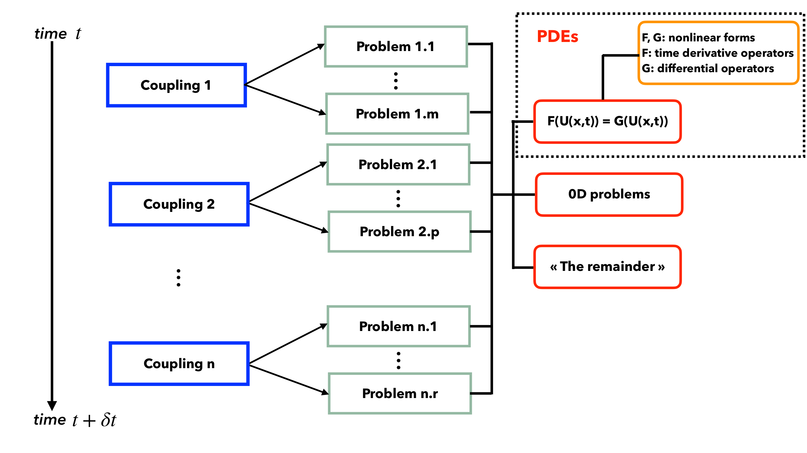
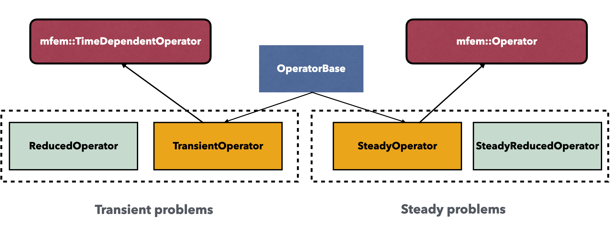
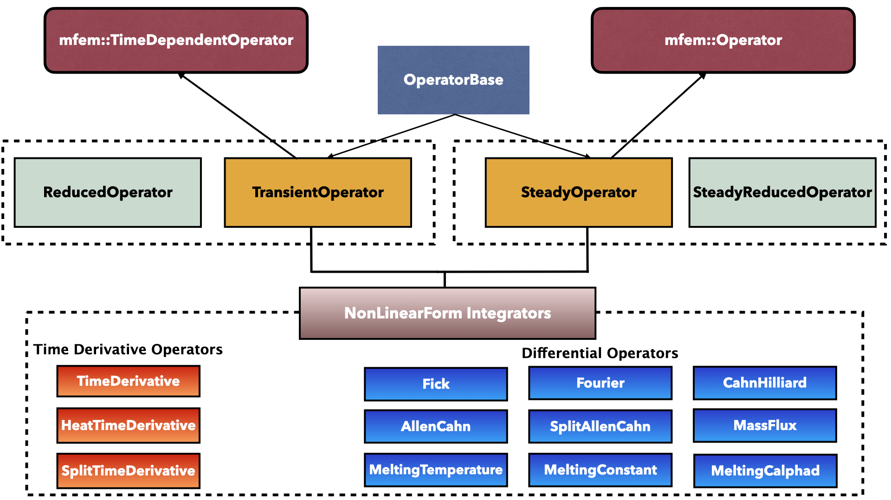

# Partial Differential Equations

## __How SLOTH solves Partial Differential Equations?__ {#PDE-intro}

Partial Differential Equations (PDEs) are the most important kind of problem for `SLOTH`.

As illustrated in the figure 1, PDEs for `SLOTH` can be expressed in the following form:

```math

\begin{align}
F(U(x,t))&=G(U(x,t))
\end{align}

```

where $`U(x,t)`$ is the vector of unknowns expressed as a function of the time $`t`$ and the position $`x`$. In this equation, $`F`$ and $`G`$ are two nonlinear forms associated with the time derivative operator and the differential operators, respectively. For steady problem, $`F=0`$.

<figure markdown="span">
  {  width=800px}
  <figcaption>Figure 1 : Schematic description of one time-step for `SLOTH` simulations with a focus on PDEs.
</figcaption>
</figure>

For `SLOTH`, PDEs solved with an implicit time-scheme (and steady PDEs) rely on a unified nonlinear algorithm, based by default on the Newton solver. This approach is adopted to maximize the generality of the implementation, although it may incur a minor computational overhead for linear PDEs. With explicit time-schemes, no nonlinear algorithm is required: only the mass matrix is inverted at each stage.

!!! note "On the choice of solvers"
    The use of a Newton solver by default represents a pragmatic choice. The nonlinear solver (Newton or L-BFGS), the linear solver and its preconditioner, as well as the solver used to invert the mass matrix, can be overloaded: see the [Solvers](../../../Solvers/index.md) page.


Definition of PDEs for `SLOTH` is made with a C++ object of type `Problem`, which is a template class instantiated with three template parameters: first, an `OPERATOR` object, second, a [Variables](../../../Variables/index.md) object (see `VARS` in the example), and third, a [PostProcessing](../../../PostProcessing/index.md) object (see `PST` in the example).


The `OPERATOR` object in `Problem` refers to an object that inherits from base classes responsible for solving the nonlinear system (1). 
These classes are illustrated in the figure 2: `OperatorBase` is a base class with two derived classes:

- `TransientOperatorBase`, which inherits from the `TimeDependentOperator` class of `MFEM` and is dedicated to unsteady PDEs,
- `SteadyOperatorBase`, which inherits from the `Operator` class of `MFEM` and is dedicated to steady PDEs. 

In addition to these classes, there are two classes used to compute the residual and the Jacobian associated with the Newton-Raphson algorithm -- see `ReducedOperator` and `SteadyReducedOperator` classes in the figure 2.

<figure markdown="span">
  {  width=800px}
  <figcaption>Figure 2 : Three main classes managing the resolution of the non linear system.
</figcaption>
</figure>

As illustrated in the figure 3, these operators are associated with `NonLinearFormIntegrators` which are used to compute the residual vector and the Jacobian matrix for the nonlinear problems.

<figure markdown="span">
  {  width=800px}
  <figcaption>Figure 3 : Specific `Integrators` implemented in `SLOTH`.
</figcaption>
</figure>

## __How to define Partial Differential Equations?__ {#PDE-details}

### __Integrators__ {#integrators}

All `SLOTH` integrators inherit from the `MFEM` `BlockNonlinearFormIntegrator` class. 
In the figure 3, the integrators are gathered in two grouped:

- Time Derivative Integrators (see $`F`$ in the equation (1)): `TimeDerivative`, `SplitTimeDerivative`, `HeatTimeDerivative`. **They are only used for transient problems**. 
  
    === "TimeDerivative"
        This integrator concerns the following mathematical expression:
        
        ```math

        \begin{align}
        \frac{\partial \varphi}{\partial t}
        \end{align}

        ```

        For explicit time-discretization, two `SLOTH` coefficients of type `GlossaryType::ExplicitTime_A` and `GlossaryType::ExplicitTime_B` can be defined, respectively. 
        By default, these coefficients are set to one. 

        ```C++
        Coefficient explicit_time_A(Glossary::ExplicitTime_A, 1.0);
        Coefficient explicit_time_B(Glossary::ExplicitTime_B, 1.0);
        ```


    === "SplitTimeDerivative"
        This integrator concerns the following vectorial expression:
        
        ```math

        \begin{pmatrix}
        0
        \\
        \displaystyle\frac{\partial \varphi}{\partial t}
        \end{pmatrix}

        ```
        This integrator must be associated with the `SplitAllenCahn` and `CahnHilliard` integrators.

    === "HeatTimeDerivative"
        This integrator concerns the following mathematical expression:
        
        ```math

        \begin{align}
        \rho C_p\frac{\partial T}{\partial t}
        \end{align}

        ```
        where $`\rho`$ and $`C_p`$ are two `SLOTH` coefficients of type `GlossaryType::Concentration` and `GlossaryType::HeatCapacity`, respectively. 
        By default, coefficients are set to one. 

- Differential Operators  (see $`G`$ in the equation (1)): `Fick`, `Fourier`, `MassFlux`, `AllenCahn`, `SplitAllenCahn`, `CahnHilliard`, `MeltingCalphad`, `MeltingConstant`, `MeltingTemperature`, `LatentHeat`, `SourceTerm`, `Advection`, `SplitAdvection`. **They can be combined as for example, `AllenCahn` and  `MeltingTemperature`**.
  
    === "Fick"
        This integrator concerns the following mathematical expression:
        
        ```math

        \begin{align}
        \nabla\cdot \left[D(\varphi)\nabla \varphi \right]
        \end{align}

        ```
        where $`D`$ is a **mandantory** `SLOTH` coefficient of type `GlossaryType::Diffusivity`.

    === "Fourier"
        This integrator concerns the following mathematical expression:
        
        ```math

        \begin{align}
        \nabla\cdot \left[k(T)\nabla T \right]
        \end{align}

        ```
        where $`k`$ is a **mandantory** `SLOTH` coefficient of type `GlossaryType::Conductivity`.

    === "MassFlux"
        This integrator concerns the following mathematical expression:
        
        ```math

        \begin{align}
        \sum_{i}\nabla \cdot \left(M_i \nabla \zeta_i\right)
        \end{align}

        ```
        where $`M_i`$ are mobility-type coefficients and $\zeta_i$ diffusion potentials. The latter can be defined as a function of chemical potentials $`\mu_i`$ or diffusion potentials $`\mu_i-\mu_n`$, which can themselves be scaled by temperature:

        ```math

        \begin{array}{l}
        \zeta_i\leadsto\mu_i
        \\
        \zeta_i\leadsto\displaystyle\frac{\mu_i}{T}
        \\
        \zeta_i\leadsto {\mu_i-\mu_n}
        \\
        \zeta_i\leadsto\displaystyle\frac{\mu_i-\mu_n}{T}
        \end{array}

        ```

        Three parameters are available with this integrator. They are listed in the table 1.

          | Parameter Name                      | Type   | Default Value | Description                                                             |
          | ----------------------------------- | ------ | ------------- | ----------------------------------------------------------------------- |
          | `ScaleVariablesByTemperature`       | `bool` | false         | indicates wheter potentials are scaled by temperature            |
          | `ScaleCoefficientsByTemperature`    | `bool` | false         | indicates wheter mobility coefficients are scaled by temperature |
          | `EnableDiffusionChemicalPotentials` | `bool` | false         | indicates wheter diffusion potentials are considered             |
          
          : Table 1 - parameters allowed with `MassFlux`

          For simulations based on this integrator, temperature, potentials and mobility coefficients must be defined as an auxiliary variable of problem.


    === "AllenCahn"
        This integrator concerns the following vectorial expression:
        
        ```math

        \begin{align}
        M_i{\left(\nabla \cdot \left[\lambda_i \nabla \varphi_i\right] - \displaystyle\frac{\partial F_i}{\partial \varphi_i}\right)}_i
        \end{align}

        ```
        where $`M_i`$, $`\lambda_i`$, and $`F_i`$ are  **mandantory** `SLOTH` coefficients of type `GlossaryType::Mobility`, `GlossaryType::Capillary` and `GlossaryType::FreeEnergy`, respectively.
    === "SplitAllenCahn"
        This integrator concerns the following vectorial expression:
        
        ```math

        \Biggl(
        \begin{array}{c}
        \eta - \nabla \cdot \left(\lambda \nabla \varphi\right)
        + \dfrac{\partial F}{\partial \varphi} \\
         M \eta
        \end{array}
        \Biggr)

        ```
        where $`M`$, $`\lambda`$, and $`F`$ are  **mandantory** `SLOTH` coefficients of type `GlossaryType::Mobility`, `GlossaryType::Capillary` and `GlossaryType::FreeEnergy`, respectively. 

        This integrator must be associated with the `SplitTimeDerivative` integrator.
        
    === "CahnHilliard"
        This integrator concerns the following vectorial expression:
        
        ```math

        \Biggl(
        \begin{array}{c}
        \mu - \nabla \cdot \left(\lambda \nabla \varphi\right)
        + \dfrac{\partial F}{\partial \varphi} \\
        \nabla \cdot \left(M \nabla \mu\right)
        \end{array}
        \Biggr)

        ```
        where $`M`$, $`\lambda`$, and $`F`$ are  **mandantory** `SLOTH` coefficients of type `GlossaryType::Mobility`, `GlossaryType::Capillary` and `GlossaryType::FreeEnergy`, respectively. 

        This integrator must be associated with the `SplitTimeDerivative` integrator.

    === "MeltingConstant"
        This integrator concerns the following mathematical expression:
        
        ```math

        \begin{align}
        M \alpha p'(\varphi) 
        \end{align}

        ```
        where $`M`$, $`p`$ are **mandantory** `SLOTH` coefficients of type `GlossaryType::Mobility` and `GlossaryType::PhaseFieldPotential`, respectively. 

        $`\alpha`$ is the enthalpy of melting. It is constant and equal to the value of parameter named `melting_factor`.
        
        This integrator can be used to simulate melting phenomena based on an ad-hoc melting contribution.

        For these simulations, it must be associated with the `AllenCahn` integrator.

        
    === "MeltingTemperature"
        This integrator concerns the following mathematical expression:
        
        ```math

        \begin{align}
        M \alpha p'(\varphi) 
        \end{align}

        ```
        where $`M`$, $`p`$ are **mandantory** `SLOTH` coefficients of type `GlossaryType::Mobility` and `GlossaryType::PhaseFieldPotential`, respectively. 

        $`\alpha`$ is the enthalpy of melting defined by:

        ```math

        \begin{align}
        \alpha&=&H_m\, ?\, T\geq T_m : 0  
        \end{align}

        ```
        where $`H_m`$ is the enthalpy of melting, $`T`$ the temperature and $`T_m`$ the temperature of melting.

        This integrator can be used to simulate melting phenomena based on an ad-hoc melting contribution.

        For these simulations, it must be associated with the `AllenCahn` integrator.

        Two mandatory parameters are requested by this integrator. They are listed in the table 1.

          | Parameter Name        | Type     | Default Value | Description         |
          | --------------------- | -------- | ------------- | ------------------- |
          | `melting_temperature` | `double` |               | melting temperature |
          | `melting_enthalpy`    | `double` |               | melting enthalpy    |
          
          : Table 1 - parameters allowed with `MeltingTemperature`

          For simulations based on this integrator, temperature must be defined as an auxiliary variable of the phase-field problem.

    === "MeltingCalphad"
        This integrator concerns the following mathematical expression:
        
        ```math

        \begin{align}
        M \alpha  \left[ p'(\varphi) + \mathcal{S}\right]
        \end{align}

        ```
        where $`M`$, $`p`$ are **mandantory** `SLOTH` coefficients of type `GlossaryType::Mobility` and `GlossaryType::PhaseFieldPotential`, respectively. 
        
        $`\mathcal{S}`$ is an optional seed value mimicking a nucleus calculated by a CALPHAD problem. 

        $`\alpha`$ is the enthalpy of melting calculated by a CALPHAD problem.

        This integrator can be used for CALPHAD-informed phase-field simulation[@introini2021phase]. 
        For these simulations, it must be associated with the `AllenCahn` integrator.

        Two mandatory parameters are requested by this integrator. They are listed in the table 1.

          | Parameter Name    | Type          | Default Value | Description                      |
          | ----------------- | ------------- | ------------- | -------------------------------- |
          | `primary_phase`   | `std::string` |               | name of the phase before melting |
          | `secondary_phase` | `std::string` |               | name of the phase after melting  |
          
          : Table 1 - parameters requested by `MeltingCalphad`

          For simulations based on this integrator, CALPHAD outputs -driving forces and nucleus- must be defined as auxiliary variables of the phase-field problem.

    === "LatentHeat"
        This integrator concerns the following mathematical expression:
        
        ```math

        \begin{align}
        \dfrac{1}{M}\left[ \dfrac{\partial \varphi}{\partial t} \right]^2 \\
        \end{align}

        ```
        where $`M`$ is a **mandantory** `SLOTH` coefficient of type `GlossaryType::Mobility`. 

        This integrator can be only associated with the `Fourier` integrator to solve heat transfer equation for two-phase problems. 

        The phase field $`\varphi`$ is an auxiliary variable of the heat problem. Its time derivative is computed from its current and previous values with the **physical** time step:

        ```math

        \begin{align}
        \frac{\partial \varphi}{\partial t} \approx \frac{\varphi - \varphi_{\mathrm{old}}}{\Delta t}
        \end{align}

        ```

        !!! warning "Accuracy of the time derivative"
            This approximation is first order in time, whatever the time scheme: a coupling with latent heat is first order, even with `TimeScheme::BDF2`. 
            Moreover, it depends on the position of the phase-field problem in the [partitioned coupling](#bdf2-coupling): if the phase-field problem is solved **before** the heat problem, the derivative is computed over the current time step; otherwise, it is the derivative of the previous time step.

    === "SourceTerm"
        This integrator concerns the following vectorial expression:
        
        ```math

        \begin{align}
        {\left(f_i\right)}_i
        \end{align}

        ```
        where $`f_i`$ is a **mandatory** `SLOTH` coefficient of type `GlossaryType::SourceTerm` (`Glossary::SourceTerm`), defined for **every** unknown $`i`$ of the problem (use a zero constant for an equation without source term).

        $`f_i`$ can be a constant, a function of the unknowns, of the auxiliary variables, of the time (`"constants": "(t:T)"`) and of the spatial coordinates (`"coordinates"`), or read from a file (see [Coefficients](../../../Coefficients/index.md)). 
        The Jacobian $`\partial f_i/\partial u_j`$ is only assembled for source terms that can depend on the current solution (neither constant, explicit nor file-based). 
        In axisymmetric geometry, the radial weight is applied by the integrator.

        ```c++
        Coefficient no_source(Glossary::SourceTerm, 0.);
        Coefficient source(Glossary::SourceTerm, Scheme::Explicit, SourceCoefficient());
        Coefficients coef_pb0(double_well, capillary, mobility, grad_energy, no_source);
        Coefficients coef_pb1(double_well, capillary, mobility, grad_energy, source);
        TransientOPE oper(spatials, {"CahnHilliard", "SourceTerm"}, params, TimeScheme::EulerImplicit, "SplitTimeDerivative");
        ```

        This integrator can be combined with any other differential operator. It replaces the former definition of source terms on the [`Operator`](#operators).

    === "Advection"
        This integrator concerns the following mathematical expression (conservative form):
        
        ```math

        \begin{align}
        -\nabla\cdot\left(\varphi\,\mathbf{v}\right)
        \end{align}

        ```
        where $`\mathbf{v}`$ is an **imposed** velocity field (not necessarily divergence-free), defined in one of the two following ways:

        - **velocity components**: `SLOTH` coefficients of type `GlossaryType::Velocity`: `Glossary::Velocity_X`, `Glossary::Velocity_Y` and `Glossary::Velocity_Z` (all the components of the space dimension are required),
        - **gradient of an auxiliary variable** $`\mathbf{v} = \alpha\,\nabla a`$: a `SLOTH` coefficient of type `GlossaryType::VelocityPrefactor` (`Glossary::VelocityPrefactor`) for $`\alpha`$, and the parameter `velocity_gradient` giving the symbol of the auxiliary variable $`a`$ (set with `set_additional_information`).

        The velocity can depend on the spatial coordinates, the time and the auxiliary variables, **not on the unknowns** (no $`\partial \mathbf{v}/\partial \varphi`$ in the Jacobian). In the gradient mode, $`\alpha`$ and $`a`$ are frozen in the Jacobian (staggered coupling).

        Each unknown holding the velocity coefficients is advected. The weak form reads:

        ```math

        \begin{align}
        -\int_\Omega \nabla\cdot\left(\varphi\,\mathbf{v}\right)\psi\, d\Omega = \int_\Omega \varphi\,\mathbf{v}\cdot\nabla\psi\, d\Omega - \int_{\partial\Omega} \left(\mathbf{v}\cdot\mathbf{n}\right)\varphi\,\psi\, d\Gamma
        \end{align}

        ```

        The boundary term is handled by the `AdvectionBoundary` integrator, added **automatically** on each boundary holding an `Inflow` coefficient (see [Boundary conditions](../../../SpatialDiscretization/BoundaryConditions/index.md)). 
        On boundaries without `Inflow` coefficient, the advective flux vanishes (wall), which ensures mass conservation in a closed domain.

        === "Velocity components"

            ```c++
            Coefficient velocity_x(Glossary::Velocity_X, Scheme::Explicit, VelocityX());
            Coefficient velocity_y(Glossary::Velocity_Y, Scheme::Explicit, VelocityY());
            Coefficients coef_pb(density, heat_capacity, conductivity, velocity_x, velocity_y);
            TransientOPE oper(spatials, {"Fourier", "Advection"}, params, TimeScheme::EulerImplicit, "HeatTimeDerivative");
            ```

        === "Gradient of an auxiliary variable"

            ```c++
            // v = alpha grad(a), a being an auxiliary variable of the problem
            auto a_var = VAR(&spatial, bcs, "a", Glossary::Temperature, 2, a_initial_condition);
            a_var.set_additional_information("a");
            auto aux_vars = VARS(a_var);

            Coefficient alpha(Glossary::VelocityPrefactor, 1.);
            auto params = Parameters(Parameter("velocity_gradient", "a"));
            Coefficients coef_pb(density, heat_capacity, conductivity, alpha);
            TransientOPE oper(spatials, {"Fourier", "Advection"}, params, TimeScheme::EulerImplicit, "HeatTimeDerivative");
            TransientPB heat_pb("Heat", oper, heat_vars, {coef_pb}, pst, aux_vars);
            ```

            The gradient is the gradient of the finite element field $`a_h`$: it is piecewise constant with $`\mathcal{Q}_1`$ elements, which limits the accuracy of the advection to order 1. 
            A $`\mathcal{Q}_2`$ discretization of $`a`$ is recommended when the accuracy of the velocity matters (see `tests/HeatTransfer/2D/test9`).

    === "SplitAdvection"
        This integrator concerns the following vectorial expression:
        
        ```math

        \begin{pmatrix}
        0
        \\
        -\nabla\cdot\left(\varphi\,\mathbf{v}\right)
        \end{pmatrix}

        ```
        It is the counterpart of `Advection` for the split $`(\varphi, \mu)`$ Cahn-Hilliard formulation: the advection of $`\varphi`$ (first unknown) is added to the second equation, which holds $`\partial\varphi/\partial t`$. 
        The velocity coefficients (`Glossary::Velocity_X`, `Glossary::Velocity_Y`, `Glossary::Velocity_Z`, or `Glossary::VelocityPrefactor` with the parameter `velocity_gradient`, as for `Advection`) must be given in the `Coefficients` of $`\varphi`$.

        This integrator must be associated with the `CahnHilliard` and `SplitTimeDerivative` integrators. 
        On open boundaries, the `AdvectionBoundaryCH` integrator is added **automatically** on each boundary holding an `Inflow` coefficient (also given in the `Coefficients` of $`\varphi`$).

        ```c++
        Coefficient velocity_x(Glossary::Velocity_X, 0.);
        Coefficient velocity_y(Glossary::Velocity_Y, Scheme::Explicit, PoiseuilleVelocity());
        Coefficients coef_phi(double_well, capillary, mobility, grad_energy, velocity_x, velocity_y);
        Coefficients coef_mu(double_well, capillary, mobility, grad_energy);
        TransientOPE oper(spatials, {"CahnHilliard", "SplitAdvection"}, params, TimeScheme::EulerImplicit, "SplitTimeDerivative");
        ```
        See the [Cahn-Hilliard example 6](../../../../../Started/Examples/CahnHilliard/example6/index.md) (rising bubble in an imposed flow).

!!! note "On the inheritance from `BlockNonlinearFormIntegrator` instead of `NonlinearFormIntegrator`"
    For `SLOTH` integrators, inheriting from `BlockNonlinearFormIntegrator` maximizes the generality of the implementation, as it allows solving both single-unknown problems and problems with several unknowns. 
 
### __Operators__ {#operators}

=== "TransientOperator"

    This operator allows solving transient problems.


    `TransientOperator` is a template class instantiated with two template parameters: first, the kind of finite element and second, the spatial dimension.

    !!! example "Alias declaration for `TransientOperator` class template"
        The alias `TransientOPE` is provided by `SLOTH` namespaces (see the [Aliases page](../../../Aliases/index.md)) for operator used in unsteady problems

    The `TransientOPE` operator must be defined by:

    - a vector of spatial discretisation objects (see [Meshing](../../../SpatialDiscretization/Meshing/index.md)) [required], 
    - a vector of strings specifying the integrators used to model spatial differential operators [required],
    - a set of parameters (see [Parameters](../../../Parameters/index.md)) [optional],
    - a ODE solver for time stepping [required],
    - a string specifying the integrator used to model time derivative operator [required].
  
    !!! warning "On the size of the vector of spatial discretisation objects"
        In `SLOTH`, each operator is designed to solve a system of PDEs with a monolithic algorithm.
        **The size of the vector of spatial discretisation objects must be equal to the number of unknowns**.

    Regarding the time stepping, six ODE solvers are available in `SLOTH`: five are provided by `MFEM`, and a variable-step BDF2 method is implemented in `SLOTH`:

    - implicit methods (solved with the nonlinear algorithm):
        -  The backward Euler method  (`SLOTH` object `TimeScheme::EulerImplicit`),
        -  The two-stage, third-order singly diagonal implicit Runge-Kutta method  (`SLOTH` object `TimeScheme::SDIRK23`),
        -  The three-stage, third-order singly diagonal implicit Runge-Kutta method  (`SLOTH` object `TimeScheme::SDIRK33`),
        -  The variable-step, second-order backward differentiation formula (`SLOTH` object `TimeScheme::BDF2`), see [How to use the BDF2 time scheme?](#bdf2),
    - explicit methods (only the mass matrix is inverted):
        -  The forward Euler method  (`SLOTH` object `TimeScheme::EulerExplicit`),
        -  The Runge-Kutta 4 method (`SLOTH` object `TimeScheme::RungeKutta4`).

    | Time scheme | Order | Nonlinear solves per time step |
    | --- | :---: | :---: |
    | `TimeScheme::EulerImplicit` | 1 | 1 |
    | `TimeScheme::BDF2` | 2 | 1 |
    | `TimeScheme::SDIRK23` | 3 | 2 |
    | `TimeScheme::SDIRK33` | 3 | 3 |
    | `TimeScheme::EulerExplicit` | 1 | - |
    | `TimeScheme::RungeKutta4` | 4 | - |

    : Table 2 - time schemes available in `SLOTH`
  
    !!! note "Extension of the list of ODE solver in `SLOTH`"
        `MFEM` provides several other ODE solvers. `SLOTH` development team integrates the most common methods, namely Euler, SDIRK and Runge-Kutta 4 methods, and a variable-step BDF2 method. 

        In the future, this list could be extended to account for other high order methods.

    !!! example "Definition of a transient operator"
        This example assume a Cahn-Hilliard problem with two unknowns (`phi` and `mu`). 
        The `OPERATOR` object, denoted by `phasefield_ope`, is well declared with a vector of two [spatial discretization](../../../SpatialDiscretization/index.md) objects (see the alias `SPAS` provided by a [`SLOTH` namespace](../../../Aliases/index.md)), the `CahnHilliard` and `SplitTimeDerivative` integrators and an Euler Implicit time-stepping method.

        ```c++                                
        SPAS spatials{&spatial, &spatial};
        TransientOPE phasefield_ope(spatials, {"CahnHilliard"}, TimeScheme::EulerImplicit, "SplitTimeDerivative");
        ```

    !!! example "Definition of a transient operator with a combination of integrators"
        The integrators for the differential operators can be combined. 

        ```c++                                
        SPAS spatials{&spatial};
        TransientOPE phasefield_ope(spatials, {"AllenCahn", "MeltingConstant"}, TimeScheme::EulerImplicit, "TimeDerivative");
        ```
        In the following example, the operator enables to solve the following equation:
        
        ```math

        \begin{align}
        \dfrac{\partial \varphi}{\partial t} = M\left(\nabla \cdot \left[\lambda \nabla \varphi\right] - \displaystyle\frac{\partial F}{\partial \varphi}\right)+ M \alpha p'(\varphi) 
        \end{align}
        ```
        where $`\alpha`$ is a constant enthalpy of melting.

=== "SteadyOperator"

    This operator allows solving steady problems.

    `SteadyOperator` is a template class instantiated with two template parameters: first, the kind of finite element and second, the spatial dimension.

    !!! example "Alias declaration for `SteadyOperator` class template"
        The alias `SteadyOPE` is provided by `SLOTH` namespaces (see the [Aliases page](../../../Aliases/index.md)) for operator used in steady problems
    
    The `SteadyOPE` operator must be defined by:

    - a vector of spatial discretisation objects (see [Meshing](../../../SpatialDiscretization/Meshing/index.md)) [required], 
    - a vector of strings specifying the integrators used to model spatial differential operators [required],
    - a set of parameters (see [Parameters](../../../Parameters/index.md)) [optional].
      
    !!! warning "On the size of the vector of spatial discretisation objects"
        In `SLOTH`, each operator is designed to solve a system of PDEs with a monolithic algorithm.
        **The size of the vector of spatial discretisation objects must be equal to the number of unknowns**.
  

    !!! example "Definition of a steady operator"
        This example assume an Allen-Cahn problem with one unknowns (`phi`). 
        The `OPERATOR` object, denoted by `phasefield_ope`, is well declared with a vector of one [spatial discretization](../../../SpatialDiscretization/index.md) object and the `AllenCahn`  integrator.

        ```c++                                
        SPAS spatials{&spatial, &spatial};
        SteadyOPE phasefield_ope(spatials, {"AllenCahn"});
        ```
    

### __Problems__ {#problems}
As already mentioned, `Problem` for `SLOTH` is a template class instantiated with three template parameters: first, an `OPERATOR` object, second, a [Variables](../../../Variables/index.md) object, and third, a [PostProcessing](../../../PostProcessing/index.md) object.


!!! example "Alias declaration for `Problem` class template"
    The aliases `SteadyPB` and `TransientPB` are provided by `SLOTH` namespaces (see the [Aliases page](../../../Aliases/index.md)) for steady and unsteady problems, respectively.


The `SteadyPB` and `TransientPB` problems must be defined by:

  - a [`TransientOPE/SteadyOPE`](#operators) [required], 
  - primary [Variables](../../../Variables/index.md) [required],
  - a vector of [Coefficients](../../../Coefficients/index.md) [required],
  - a set of parameters (see [Parameters](../../../Parameters/index.md)) [optional],
  - an [PostProcessing](../../../PostProcessing/index.md) object [optional], 
  - a set of [auxiliary Variables](../../../Variables/index.md) [optional].


!!! warning "On the size of the vector of `Coefficients` objects"
    **The size of the vector of `Coefficients` objects must be equal to the number of variables**.

!!! warning "On the order of the vector of `Coefficients` objects"
    **The order of coefficent in the vector of `Coefficients` objects corresponds the order unknowns in the `Variables` object**.


  
!!! example "Definition of a Cahn-Hilliard problem"

    ```c++                                
    SPAS spatials{&spatial, &spatial};

    // Variables: phi, mu
    auto phi = VAR(&spatial, bcs_phi, "phi", Glossary::PhaseField, 2, phi_initial_condition);
    auto mu = VAR(&spatial, bcs_mu, "mu", Glossary::ChemicalPotential, 2, mu_initial_condition);
    auto vars = VARS(phi, mu);
    
    // Operator
    TransientOPE phasefield_ope(spatials, {"CahnHilliard"}, TimeScheme::EulerImplicit, "SplitTimeDerivative");

    // Coefficients
    //  Interface thickness
    const double epsilon(0.02);
    // Two-phase mobility
    const double mob(1.);
    // Gradient coefficient
    const double lambda = (epsilon * epsilon);
    Coefficient grad_energy(Glossary::GradEnergy, Scheme::Implicit, GradientEnergy(lambda));
    Coefficient double_well(Glossary::FreeEnergy, Scheme::Implicit, W(omega));
    Coefficient capillary(Glossary::Capillary, lambda);
    Coefficient mobility(Glossary::Mobility, mob);

    Coefficients coef_phase_field(double_well, capillary, mobility, grad_energy);

    // Problem (pst is PostProcessing object not detailed here)
    TransientPB phase_field_pb(phasefield_ope, vars, {coef_phase_field, coef_phase_field}, pst);

    ```

    This example assume an two-phase problem solved by Cahn-Hilliard equations with two unknowns (`phi` and `mu`). 

    ```math

    \begin{pmatrix}
    0 
    \\
    \dfrac{\partial \varphi}{\partial t} 
    \end{pmatrix}

    =

    \begin{pmatrix}
    \mu - \nabla \cdot \left(\lambda \nabla \varphi\right)
    \\[1ex]
    \nabla \cdot \left(M \nabla \mu\right)
    \end{pmatrix}

    ```

    The `TransientOPE` object, denoted by `phasefield_ope`, is well declared with a vector of two [spatial discretization](../../../SpatialDiscretization/index.md) objects (see the alias `SPAS` provided by a [`SLOTH` namespace](../../../Aliases/index.md)), the `CahnHilliard`  integrator for the right-hand-side of PDEs and the `SplitTimeDerivative` for the left-hand-side. 

    For this example, the Backward Euler method is considered (see `TimeScheme::EulerImplicit`).

    For this problem, a vector of two [Coefficients](../../../Coefficients/index.md) is considered for `phi` and `mu`, respectively. Here, the same `Coefficients` are used for both variables accordingly with the `CahnHilliard` integrator. 
    As expected by this integrator, coefficients of type `Glossary::FreeEnergy`, `Glossary::Capillary` and `Glossary::Mobility` are defined. The coefficient of type `Glossary::GradEnergy` is only used to compute the gradient terms in the output of the density of energy. 

    This example has no parameters or auxiliary variables.

#### __How to perform simulations on axisymmetric geometries?__ {#axi}
    
To enable simulations on axisymmetric geometries, the current definition of the `Problem` class needs to be enhanced. The proposed modification is as follows:

```c++

    TransientPB phase_field_pb(phasefield_ope, vars, {coef_phase_field, coef_phase_field}, pst);
    phase_field_pb.setGeometry(Geometry::Axisymmetric);

```

By default, the geometry will be set to `Geometry::Cartesian` if no specific geometry is defined.


!!! warning "Defining source terms on axisymmetric geometries"

    Source terms are defined with the [`SourceTerm`](#integrators) integrator, which applies the radial weight automatically, as all the other integrators. The source term coefficient must therefore **not** be multiplied by the radius.


#### __How to use Adaptive Mesh Refinement (AMR)?__ {#amr}
 
Once a `Problem` is fully defined, an AMR driver can be attached to it so that `SLOTH` locally refines/coarsens the mesh — and every finite element space and variable (primary + auxiliary) built on it — as the simulation progresses. This assumes the [spatial discretization](../../../SpatialDiscretization/Meshing/index.md) used by the problem was built with `enable_nc_mesh = true`.
 
!!! example "Attaching AMR to the Cahn-Hilliard problem defined above"
    ```c++
        mfem::ConstantCoefficient amr_coef{1.0};
        mfem::DiffusionIntegrator amr_integ{amr_coef};
        SlothErrorEstimators estimator(ErrorEstimatorType::KELLY, &amr_integ);
    
        SingleVariableAMR<VARS> amr(*spatial.get_mesh(), spatial.is_nc_simplices(), 0);

        auto amr_params = Parameters(Parameter("max_elem_error", 1.e-4), Parameter("amr_max_level", 4),
                               Parameter("nc_limit", 0), Parameter("max_preref_cycles", 4));
        amr.SetCriteria(/*estimator*/ &estimator, amr_params);
    
        phase_field_pb.set_amr(&amr);
    ```
    An error estimator is first built from an `MFEM` integrator and wrapped into a `SlothErrorEstimators` object, then used to configure a `SingleVariableAMR` driver — here based on `phi` (index `0` in `vars`). The driver is finally attached to the problem with `set_amr()`, exactly as `setGeometry()` is used above for axisymmetric geometries.
 
!!! note "Full AMR workflow"
    This page only shows how to attach an already-configured AMR driver to a `Problem`. 

    - For the complete step-by-step workflow, see the [AMR tutorial](../../../../../Started/HowTo/Tutorials/AMR/index.md);
    - For the full reference on error estimators (`ErrorEstimatorType::KELLY`, `ErrorEstimatorType::ZZ`) and AMR drivers (`SingleVariableAMR`, `MultiVariableMaxAMR`), see the [Adaptive Mesh Refinement](../../../AMR/index.md) page of the User Manual.


#### __How to use the BDF2 time scheme?__ {#bdf2}

`TimeScheme::BDF2` is a variable-step, second-order implicit time scheme. It costs one nonlinear solve per time step, as the backward Euler method, whereas the SDIRK methods need two or three. It is well suited to stiff phase-field problems.

!!! example "Definition of a transient operator with the BDF2 time scheme"
    ```c++
    SPAS spatials{&spatial, &spatial};
    TransientOPE phasefield_ope(spatials, {"CahnHilliard"}, TimeScheme::BDF2, "SplitTimeDerivative");
    ```
    Nothing else changes in the definition of the problem.

##### __Principle__ {#bdf2-principle}

With $`\Delta t_n = t^{n+1} - t^n`$ and the ratio $`\omega = \Delta t_n / \Delta t_{n-1}`$ of two consecutive time steps, the BDF2 scheme reads:

```math

\begin{align}
U^{n+1} - a\, U^n + b\, U^{n-1} = \beta\, \Delta t_n\, \frac{\partial U}{\partial t}(t^{n+1}),
\qquad
a = \frac{(1+\omega)^2}{1+2\omega},\quad
b = \frac{\omega^2}{1+2\omega},\quad
\beta = \frac{1+\omega}{1+2\omega}
\end{align}

```

For a constant time step: $`a = 4/3`$, $`b = 1/3`$ and $`\beta = 2/3`$. 

In `SLOTH`, the scheme is solved as a backward Euler step on an effective state $`U^\star = a\, U^n - b\, U^{n-1}`$ with an effective time step $`\beta\, \Delta t_n`$: 

```math

\begin{align}
U^{n+1} = U^\star + \beta\, \Delta t_n\, K
\end{align}

```

where $`K`$ is the time derivative solved by the nonlinear algorithm. The [integrators](#integrators) are therefore the same as for the backward Euler method.

- **First time step**: no previous state is available, so the first step is a backward Euler step.
- **Variable time step**: the coefficients depend on the ratio $`\omega`$. A ratio $`\omega \geq 1+\sqrt{2}`$ is rejected (zero-stability of the variable-step BDF2 method for arbitrary step sequences, Crouzeix & Lisbona, 1984): an adaptive time step must limit the growth of the time step, for instance to $`\omega \leq 2`$.
- **Adaptive Mesh Refinement**: the previous state $`U^{n-1}`$ is taken from the history of the [Variables](../../../Variables/index.md), which is transferred by the [AMR](#amr) with the current solution. The scheme is not restarted after a mesh change.
- **Restart**: the first step after a restart is a backward Euler step.

##### __Partitioned coupling__ {#bdf2-coupling}

In a `Coupling` with several problems, the problems are solved one after the other. A problem sees the variables of the other problems as auxiliary variables: those of the problems already solved in the current time step are at $`t^{n+1}`$, those of the problems not yet solved are at $`t^n`$ (lagged).

| Problem solved | sees `Pb1` | sees `Pb2` | sees `Pb3` |
| --- | :---: | :---: | :---: |
| `Pb1` | - | $`t^n`$ (lagged) | $`t^n`$ (lagged) |
| `Pb2` | $`t^{n+1}`$ | - | $`t^n`$ (lagged) |
| `Pb3` | $`t^{n+1}`$ | $`t^{n+1}`$ | - |

: Table 3 - auxiliary variables seen by each problem of `Coupling("...", Pb1, Pb2, Pb3)`

This lag is a splitting error of order $`\Delta t`$: it keeps the backward Euler method at order 1, but limits higher-order schemes to order 1. With `TimeScheme::BDF2`, the lagged auxiliary variables are therefore **automatically** replaced, during the time step, by the second-order extrapolation

```math

\begin{align}
\tilde{B} = (1+\omega)\, B^n - \omega\, B^{n-1}
\end{align}

```

and restored after the time step. The lagged auxiliary variables are detected automatically, whatever the order of the problems in the `Coupling`. With the other time schemes, they are reported once (in `Verbosity::Verbose`).

An extrapolated value may leave the physical range of the variable (e.g. $`\tilde{\varphi} > 1`$ near a moving interface). Physical bounds can be given to the variable: the extrapolated value is then truncated in these bounds. As long as the bounds contain the exact solution, the truncation keeps the second order.

!!! example "Bounds of the extrapolated value"
    ```c++
    auto eta = VAR(&spatial, bcs, "eta", Glossary::PhaseField, 2, eta_initial_condition);
    eta.set_extrapolation_bounds(0., 1.);   // or (-1., 1.), depending on the formulation
    auto ac_vars = VARS(eta);
    ```
    The bounds must be set **before** the variable is added to a `VARS` object. They only apply to the extrapolated value of a lagged auxiliary variable (BDF2): neither the solution itself nor the other time schemes are affected.

##### __Limitations__ {#bdf2-limitations}

!!! warning "Explicit coefficients of the unknowns"
    With `TimeScheme::BDF2`, `Scheme::Explicit` coefficients (and the previous value of `Scheme::SemiImplicit` coefficients) that depend on the unknowns of the problem are evaluated on the effective state $`U^\star`$, which is not a physical state: for a constant time step, $`U^\star = U^n + (U^n - U^{n-1})/3`$ may leave the physical range where the variable still varies near a bound. 

    This matters for coefficients only defined on a bounded range, e.g. an explicit mobility with a $`c(1-c)`$ term. For such coefficients:

    - prefer `Scheme::Implicit` (evaluated at the end of the time step: safe and second order),
    - otherwise, bound the argument inside the coefficient function,
    - or keep the backward Euler method.

    Implicit and constant coefficients, as well as explicit coefficients depending only on the time, the coordinates or the auxiliary variables, are not affected.

!!! warning "Time derivatives of auxiliary variables"
    Integrators computing the time derivative of an auxiliary variable (e.g. [`LatentHeat`](#integrators)) use a first-order approximation: a coupling involving such integrators is first order, even with `TimeScheme::BDF2`.

#### __How to set auxiliary variables after construction?__ {#set-auxvariables}

Auxiliary variables (see [Variables](../../../Variables/index.md)) can be set afterwards with `set_auxvariables`, exactly as `set_amr` is used above to attach an AMR driver:

!!! example "Setting auxiliary variables after construction"
    ```c++
    std::vector<VARS*> aux_vect = {&aux_vars_1, &aux_vars_2};
    phase_field_pb.set_auxvariables(aux_vect);
    ```
    `aux_vect` is a `std::vector<VARS*>`. This is particularly convenient in partitioned multiphase-field simulations, where each `Problem` needs the other `Variables` as auxiliary variables.


#### __How to export a `Coefficient` in VTK output?__ {#set-vtk-coefficients}

In addition to the primary [Variables](../../../Variables/index.md), quantities computed from a [`Coefficient`](../../../Coefficients/index.md) — not resolved by the system, but useful for visualization or diagnostics - can be exported to VTK output. The coefficient must first be given a name, then registered on the `Problem` with `set_vtk_coefficients`:

!!! example "Registering a Coefficient for VTK output"
    In this example, the `Coefficient` named Squares is exported to VTK output.

    ```c++
    Coefficient squares(Glossary::PhaseField, Scheme::Implicit, Squares());
    squares.set_name("Squares");

    phase_field_pb.set_vtk_coefficients({squares});
    ```
    `set_vtk_coefficients` takes a `std::vector<Coefficient>`, so several coefficients can be registered at once. Each is projected onto a grid function and saved alongside the usual `Variables`, using its name (`"Squares"` here) as the field name in the VTK output.