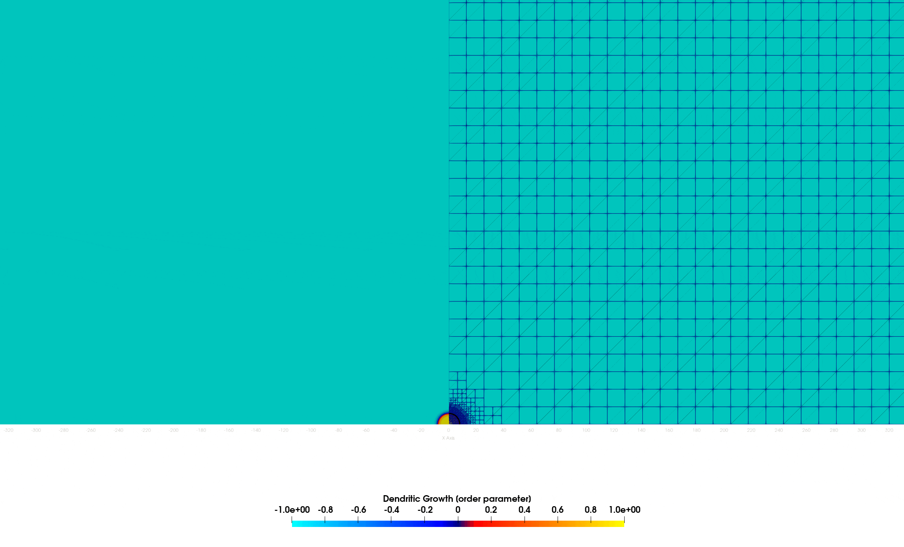

# **Example 4: dendritic growth of a pure substance**

### __Files__ 

- Comprehensive test file: [main.cpp](https://github.com/Collab4Sloth/SLOTH/tree/master/tests/Studies/DendriticGrowth/test1/main.cpp)
- Free energy and relaxation time: [coefficients.json](https://github.com/Collab4Sloth/SLOTH/tree/master/tests/Studies/DendriticGrowth/test1/coefficients.json)


### __Statement of the problem__ 

This test is the benchmark problem 3 of the PFHub website [@jokisaari2018phase]: solidification and dendritic growth of a pure substance in an undercooled melt, with the model of Karma and Rappel. It couples an Allen-Cahn equation for the phase field $`\phi`$ ($`-1`$ in the liquid, $`1`$ in the solid) with a heat equation for the dimensionless temperature $`U=(T-T_m)/(L/c_p)`$:

```math
\begin{align}
\tau(\mathbf{n})\frac{\partial \phi}{\partial t}&= -\frac{\delta \mathcal{F}}{\delta \phi} \text{ in }\Omega
\\[6pt]
\frac{\partial U}{\partial t}&= D\Delta U + \frac{1}{2}\frac{\partial \phi}{\partial t} \text{ in }\Omega
\end{align}
```

with the free energy

```math
\begin{align*}
\mathcal{F}=\int_\Omega \left[\frac{1}{2} W(\mathbf{n})^2|\nabla \phi|^2 -\frac{1}{2}\phi^2+\frac{1}{4}\phi^4 +\lambda U\phi\left(1-\frac{2}{3}\phi^2+\frac{1}{5}\phi^4\right)\right] d\Omega
\end{align*}
```

and the anisotropic interface thickness and relaxation time

```math
\begin{align}
W(\mathbf{n})=W_0\,a(\mathbf{n}), \qquad \tau(\mathbf{n})=\tau_0\,a(\mathbf{n})^2, 
\\
a(\mathbf{n})=1+\epsilon_4\cos(4\theta), \qquad \lambda=\frac{D\tau_0}{0.6267W_0^2},
\end{align}
```

where $`\mathbf{n}=\nabla\phi/|\nabla\phi|`$ and $`\theta`$ is the angle of $`\mathbf{n}`$ with the $`x`$ axis.

### __Initial and boundary conditions__

One quarter of a dendrite is simulated: a quarter of a solid seed of radius $`r_0=8`$ is placed at the origin,

```math
\begin{align}
\phi(r) = -\tanh\left(\frac{r-r_0}{\sqrt{2}}\right),
\end{align}
```

and the whole system is uniformly undercooled, $`U(t=0)=\Delta`$. No-flux conditions are prescribed for $`\phi`$ and $`U`$ on all the boundaries.

### **Parameters used for the test**
| Description         | Symbol         | Value                                    |
| ------------------- | -------------- | ---------------------------------------- |
| interface thickness | $`W_0`$        | $`1`$                                    |
| anisotropy strength | $`\epsilon_4`$ | $`0.05`$                                 |
| relaxation time     | $`\tau_0`$     | $`1`$                                    |
| thermal diffusivity | $`D`$          | $`10`$                                   |
| undercooling        | $`\Delta`$     | $`-0.3`$                                 |
| coupling constant   | $`\lambda`$    | $`D\tau_0/(0.6267W_0^2)\approx 15.9566`$ |
| radius of the seed  | $`r_0`$        | $`8`$                                    |
          

### __Numerical scheme__

- Time integration: Euler Implicit (default) or BDF2 (option `-bdf2`) for both problems, with a constant time step (option `-dt`). With BDF2, $`U`$ is extrapolated to $`t^{n+1}`$ in the phase-field problem, but the latent heat term remains first order in time (see [How to use the BDF2 time scheme?](../../../../Documentation/User/MultiPhysicsCouplingScheme/Problems/PDEs/index.md#bdf2))
- Spatial discretization: $`\mathcal{Q}_1`$ finite elements on a coarse uniform grid (options `-L` and `-n`) refined in the interface by [adaptive mesh refinement](../../../../Documentation/User/AMR/index.md): `SingleVariableAMR` driven by $`\phi`$ with a Kelly error estimator (options `-al` for the maximum level and `-ae` for the maximum element error, `-no-amr` to disable it), pre-refinement of the seed before time-stepping and rebalancing of the mesh after each AMR pass. $`\phi`$ and $`U`$ share the same nonconforming mesh: $`U`$ follows the refinement driven by $`\phi`$.
- Newton solver: relative tolerance $`10^{-10}`$, absolute tolerance $`10^{-12}`$
- Iterative solver (phase field): HYPRE_GMRES, preconditioner HYPRE_ILU

The non-regression test runs a reduced case ($`40\times 40`$ domain, coarse mesh of $`10\times 10`$ elements, 3 AMR levels, $`t\in[0,1]`$). The benchmark is run on a square of $`960`$ units up to $`t=1500`$, with the mesh of the MOOSE simulations of [@jokisaari2018phase]: coarse element size of $`12.8`$ and 5 AMR levels (element size of $`0.4`$ in the interface):

```shell
mpirun -np 32 ./DendriticGrowth2Dtest1 -L 960 -n 75 -al 5 -t 1500 -bdf2 -dt 0.04 -sf 250 -f 1000 -o Saves_bdf2
```

The option `-o` gives the output folder (`Saves` by default, the `CSV` files are appended to the existing ones). The option `-sf` gives the frequency of the specialized values (solid fraction, free energy, isovalue): the isovalue $`\phi=0`$ is written with all its points, so that the `CSV` file grows quickly with the length of the dendrite (more than 1 GB for the benchmark at every time step).

The time step was chosen from runs up to $`t=100`$ with the same mesh. With BDF2, the solid area and the tip position obtained with $`\delta t=0.04`$ and $`\delta t=0.01`$ agree within $`0.3\,\%`$ and the contours $`\phi=0`$ are superposed, whereas the implicit Euler scheme with $`\delta t=0.01`$ overestimates the solid area by $`2.4\,\%`$ (first order in time) and BDF2 with $`\delta t=0.1`$ delays the tips.

| Scheme         | $`\delta t`$ | Solid area at $`t=100`$ | Difference   |
| -------------- | ------------ | ----------------------- | ------------ |
| BDF2           | $`0.01`$     | $`770`$                 | reference    |
| BDF2           | $`0.04`$     | $`768`$                 | $`-0.3\,\%`$ |
| BDF2           | $`0.1`$      | $`759`$                 | $`-1.4\,\%`$ |
| Implicit Euler | $`0.01`$     | $`788.5`$               | $`+2.4\,\%`$ |

: Table 1 - Choice of the time step (runs up to $`t=100`$)

The outputs requested by the benchmark are written in the `Saves` folder: the solid fraction $`\int_\Omega (\phi+1)/2`$ from the integral of $`\phi`$, the free energy $`\mathcal{F}`$ (column `Density[J.m-3]`) and the position of the interface $`\phi=0`$, from which the tip position along the $`x`$ axis is extracted.

### __Results__ 

Figure 1 shows the growth of the dendrite up to $`t=1500`$ (BDF2, $`\delta t=0.04`$), with the adaptive mesh following the interface. The two arms of the simulated quarter grow along the directions favoured by the anisotropy, the $`x`$ and $`y`$ axes ($`\theta = 0`$ and $`\theta = \pi/2`$).

<figure markdown="span">
    {  width=800px}
    <figcaption>Figure 1: dendritic growth of a pure substance (PFHub benchmark 3), phase field and adaptive mesh
    </figcaption>
</figure>

Table 2 compares the values at $`t=1500`$ with those of the PFHub submissions whose data are available in the [PFHub repository](https://github.com/usnistgov/pfhub). The results of `SLOTH` lie among those of the implicit codes, and its tip velocity at late times is close to those of MOOSE and AMPE.

| Simulation  | Time scheme             | Tip position ($`x`$) | Solid fraction | Free energy             | Tip velocity ($`t\in[1000,1500]`$) |
| ----------- | ----------------------- | -------------------- | -------------- | ----------------------- | ---------------------------------- |
| `SLOTH`     | BDF2, $`\delta t=0.04`$ | $`276.7`$            | $`0.01789`$    | $`1.9831\times 10^{6}`$ | $`0.156`$                          |
| MOOSE (INL) | implicit                | $`280.9`$            | $`0.01878`$    | $`1.9762\times 10^{6}`$ | $`0.147`$                          |
| AMPE        | implicit Euler          | $`285.2`$            | $`0.01874`$    | $`1.9766\times 10^{6}`$ | $`0.155`$                          |
| MOOSE (ITG) | implicit                | $`264.0`$            | $`0.01698`$    | $`1.9883\times 10^{6}`$ | $`0.149`$                          |
| MEMPHIS     | explicit Euler          | $`216.8`$            | $`0.01466`$    | $`2.0084\times 10^{6}`$ | $`0.114`$                          |

: Table 2 - Values at $`t=1500`$ compared with PFHub submissions
