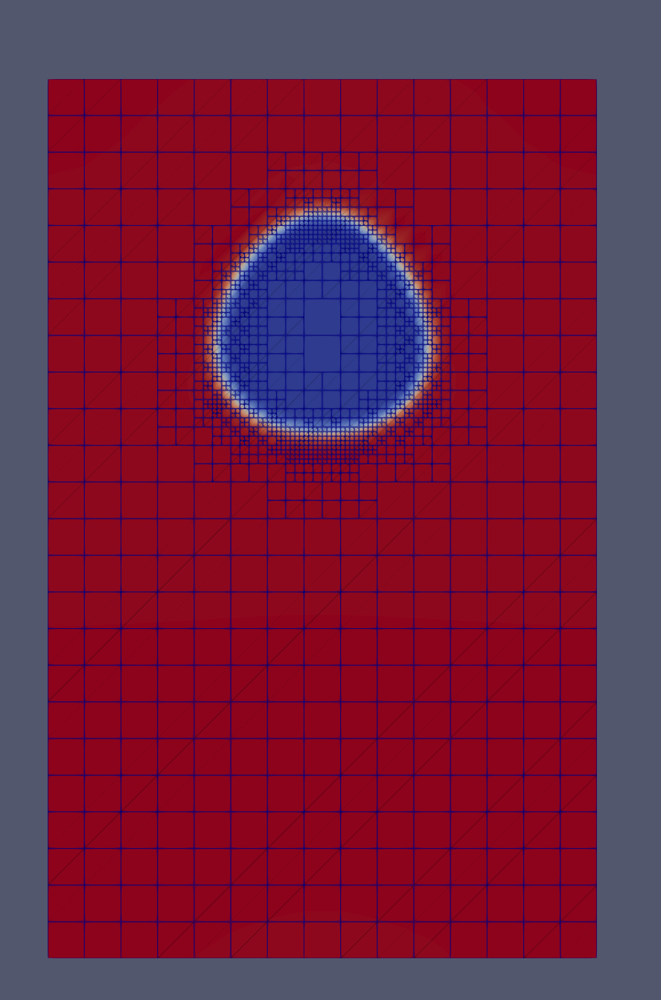

# **Example 6: rising bubble in an imposed flow (advection + AMR)**

### __Files__ 

- 2D test file: [main.cpp](https://github.com/Collab4Sloth/SLOTH/tree/master/tests/CahnHilliard/2D/test6/main.cpp)
- 3D test file: [main.cpp](https://github.com/Collab4Sloth/SLOTH/tree/master/tests/CahnHilliard/3D/test1/main.cpp)
- Velocity field: `coefficient.json` in each test directory

### __Statement of the problem__ 

This test is adapted from a rising bubble problem of C. Introïni's PhD thesis[@introini2010interaction].
It validates the advection integrators (`SplitAdvection`, `AdvectionBoundaryCH`) coupled with the Cahn-Hilliard equations, with adaptive mesh refinement.

A bubble is transported by an **imposed** velocity field $`\mathbf{v}`$ (no Navier-Stokes equations are solved):

```math

\begin{align}
\frac{\partial \phi}{\partial t}&= \nabla\cdot\left(M\nabla \mu\right) - \nabla\cdot\left(\phi\,\mathbf{v}\right) \text{ in }\Omega 
\\[6pt]    
\mu &= \omega W'(\phi) - \lambda \Delta \phi \text{ in }\Omega 
\end{align}

```

where $`\phi`$ is the phase indicator ($`\phi=0`$ in the bubble, $`\phi=1`$ in the surrounding matrix), $`\mu`$ the generalized chemical potential and $`W`$ the double-well potential:

```math

\begin{align} 
W(\phi)&=\phi^2(1-\phi)^2, \qquad \lambda=\frac{3}{2}\sigma\epsilon, \qquad \omega=\frac{12\sigma}{\epsilon}
\end{align}

```

The 2D domain $`\Omega`$ is the rectangle $`[0,R]\times[0,H]`$ with $`R=5r_b`$ and $`H=8r_b`$, where $`r_b`$ is the bubble radius. 
The imposed velocity is a Poiseuille-like profile, vanishing on the lateral walls and divergence-free:

```math

\mathbf{v} = v_{max}\left[1-\left(\frac{x-R/2}{R/2}\right)^2\right]\mathbf{e}_y

```

In 3D, the domain is $`[0,R]\times[0,H]\times[0,R]`$ ($`y`$ is the vertical direction) and the profile is parabolic in both transverse directions:

```math

\mathbf{v} = v_{max}\left[1-\left(\frac{x-R/2}{R/2}\right)^2\right]\left[1-\left(\frac{z-R/2}{R/2}\right)^2\right]\mathbf{e}_y

```

### __Initial condition__

The bubble is centred at $`(R/2, 3r_b)`$ in 2D ($`(R/2, 3r_b, R/2)`$ in 3D):

```math

\phi = \frac{1}{2} + \frac{1}{2}\tanh\left(\frac{2\left(r - r_b\right)}{\epsilon}\right), \qquad \mu = 0

```

where $`r`$ is the distance to the bubble centre. 
$`\mu=0`$ corresponds to the equilibrium of the planar tanh profile ($`\omega W'(\phi)=\lambda\phi''`$ since $`\lambda/\omega=\epsilon^2/8`$).

### **Parameters used for the test**

The physical data are those of the rising bubble problem with $`Bo=10`$ and $`Mo=10^{-2}`$, the radius being deduced from the Bond number: $`r_b = 0.5\sqrt{\sigma Bo/\left(g(\rho_2-\rho_1)\right)}`$.

| Name      | Description                              | Symbol       | Value                            |
| --------- | ---------------------------------------- | ------------ | -------------------------------- |
| `sigma`   | interfacial energy                       | $`\sigma`$   | $`7\times 10^{-2}`$ J.m$`^{-2}`$ |
| `rho1`, `rho2` | gas and liquid densities            | $`\rho_1, \rho_2`$ | $`1`$, $`10^3`$ kg.m$`^{-3}`$ |
| `bond`    | Bond number                              | $`Bo`$       | $`10`$                           |
| `rb`      | bubble radius                            | $`r_b`$      | $`4.226\times 10^{-3}`$ m        |
| `epsilon` | interface thickness                      | $`\epsilon`$ | $`r_b/7`$                        |
| `mob`     | mobility coefficient                     | $`M`$        | $`10^{-7}`$                      |
| `vmax`    | maximum velocity                         | $`v_{max}`$  | $`0.05`$ m.s$`^{-1}`$            |

### __Boundary conditions__

Two configurations are computed successively:

- **periodic**: periodic boundary conditions on all boundaries. The bubble leaving the domain at the top re-enters at the bottom.
- **open**: periodic boundary conditions on the lateral boundaries, inflow/outflow boundary conditions on the bottom and top boundaries (homogeneous Neumann conditions for $`\phi`$ and $`\mu`$ completed by the advective flux):

```math

\begin{align} 
\phi\,\mathbf{v}\cdot\mathbf{n} &= \phi_{in}\,\mathbf{v}\cdot\mathbf{n} \text{ on }\partial\Omega_{bottom} \quad (\mathbf{v}\cdot\mathbf{n} < 0,\ \phi_{in}=1)
\\[6pt]
\phi\,\mathbf{v}\cdot\mathbf{n} &= \phi\,\mathbf{v}\cdot\mathbf{n} \text{ on }\partial\Omega_{top} \quad (\mathbf{v}\cdot\mathbf{n} > 0,\ \text{free outflow})
\end{align}
```

The inflow/outflow term is activated by an `Inflow` coefficient attached to the open boundaries (see [Boundary conditions](../../../../Documentation/User/SpatialDiscretization/BoundaryConditions/index.md)). 
The velocity components are `Velocity_X`, `Velocity_Y` (and `Velocity_Z` in 3D) coefficients carried by $`\phi`$ (block 0):

```c++
Coefficient velocity_x(Glossary::Velocity_X, 0.);
Coefficient velocity_y(Glossary::Velocity_Y, Scheme::Explicit, PoiseuilleVelocity());
Coefficient inflow(Glossary::Inflow, 1.);
inflow.set_bdr_index_coef(std::vector<int>{0, 2});

Coefficients coef_phi(double_well, capillary, mobility, grad_energy, velocity_x, velocity_y, inflow);
Coefficients coef_mu(double_well, capillary, mobility, grad_energy);

SPAS spatials{&spatial_phi, &spatial_mu};
TransientOPE oper(spatials, {"CahnHilliard", "SplitAdvection"}, params, TimeScheme::EulerImplicit,
                  "SplitTimeDerivative");
```

### __Numerical scheme__

- Time integration: Euler Implicit over the interval $`t\in[0,0.6]`$ s with a time-step $`\delta t=10^{-3}`$ s
- Spatial discretization: $`\mathcal{Q}_1`$ finite elements, coarse mesh $`15\times 24`$ ($`15\times 24\times 15`$ in 3D, $`h=r_b/3`$)
- AMR: `SingleVariableAMR` driven by $`\phi`$ with a Kelly error estimator, 3 levels of refinement ($`h_{min}=r_b/24`$, i.e. about 3.4 elements in $`\epsilon`$), 3 cycles of pre-refinement of the initial condition
- AMR thresholds: `max_elem_error` $`=10^{-6}`$ in 2D ($`10^{-12}`$ in 3D), `scale_down_factor` $`=10^{-2}`$
- Newton solver: relative tolerance $`10^{-10}`$, absolute tolerance $`10^{-14}`$
- Iterative solver: HYPRE_GMRES 
- Preconditioner: HYPRE_ILU

### __Results__ 

The bubble is stretched by the Poiseuille flow (faster in the centre of the domain) and takes an ogive shape, while the refined region follows the interface and the wake is derefined (Figure 1).

<figure markdown="span">
    {  width=400px}
    <figcaption>Figure 1: rising bubble and AMR mesh (2D, periodic configuration)
    </figcaption>
</figure>

In the periodic configuration, the integral of $`\phi`$ is conserved. In the open configuration, it increases once the bubble leaves the domain through the top boundary, the bubble ($`\phi=0`$) being replaced by the matrix ($`\phi=1`$) entering at the bottom.
