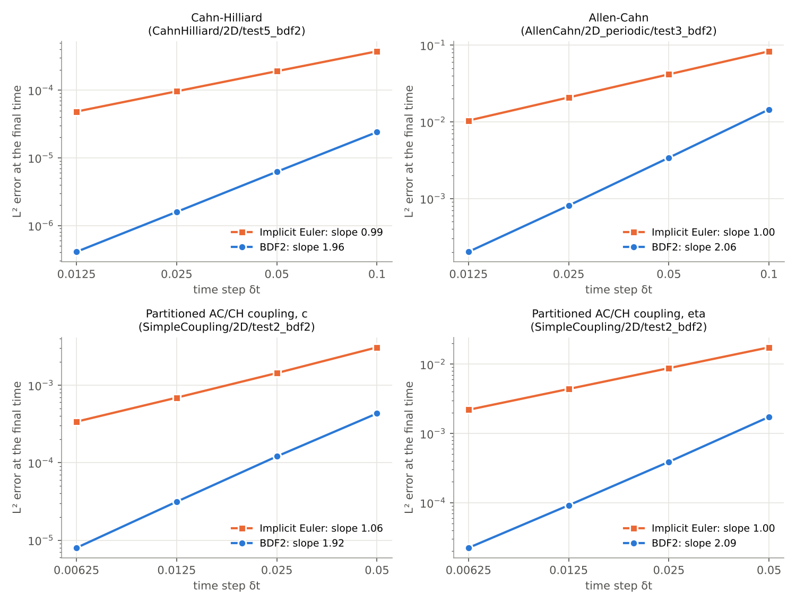

# **Example 1: convergence in time of the BDF2 scheme**

### __Files__ 

- Cahn-Hilliard equations: [main.cpp](https://github.com/Collab4Sloth/SLOTH/tree/master/tests/CahnHilliard/2D/test5_bdf2/main.cpp), reference results: [convergence_output_ref.csv](https://github.com/Collab4Sloth/SLOTH/tree/master/tests/CahnHilliard/2D/test5_bdf2/ref/convergence_output_ref.csv)
- Allen-Cahn equation: [main.cpp](https://github.com/Collab4Sloth/SLOTH/tree/master/tests/AllenCahn/2D_periodic/test3_bdf2/main.cpp), reference results: [convergence_output_ref.csv](https://github.com/Collab4Sloth/SLOTH/tree/master/tests/AllenCahn/2D_periodic/test3_bdf2/ref/convergence_output_ref.csv)
- Partitioned Allen-Cahn/Cahn-Hilliard coupling: [main.cpp](https://github.com/Collab4Sloth/SLOTH/tree/master/tests/SimpleCoupling/2D/test2_bdf2/main.cpp), reference results: [time_convergence_c.csv](https://github.com/Collab4Sloth/SLOTH/tree/master/tests/SimpleCoupling/2D/test2_bdf2/ref/time_convergence_c.csv) and [time_convergence_eta.csv](https://github.com/Collab4Sloth/SLOTH/tree/master/tests/SimpleCoupling/2D/test2_bdf2/ref/time_convergence_eta.csv)
- Post-processing script: [time_convergence.py](https://github.com/Collab4Sloth/SLOTH/tree/master/tests/tools/time_convergence.py)


### __Statement of the problem__ 

These tests verify the order of convergence in time of the [BDF2 scheme](../../../../Documentation/User/MultiPhysicsCouplingScheme/Problems/PDEs/index.md#bdf2) (`TimeScheme::BDF2`) and of the implicit Euler scheme (`TimeScheme::EulerImplicit`) with manufactured solutions. Each test solves the same problem with both schemes and a time step divided by two from one run to the next, on a fixed mesh fine enough so that the spatial error stays below the smallest time error. The $`L^2`$ error at the final time is expected to decrease as $`\delta t`$ with the implicit Euler scheme and as $`\delta t^2`$ with BDF2.

!!! note "Choice of the manufactured solutions"
    The time dependence of the manufactured solutions is not polynomial: with a solution linear in time, both schemes would be exact in time and the time error would vanish.

=== "Cahn-Hilliard"

    Variant of the [Cahn-Hilliard MMS benchmark](../../CahnHilliard/example5/index.md) [@zhang2013quantitative] on $`\Omega=[0,1]^2`$, $`t\in[0,1]`$:

    ```math
    \begin{align}
    \frac{\partial \phi}{\partial t}&= \Delta \mu + S \text{ in }\Omega 
    \\[6pt]    
    \mu &= \phi^3 - \phi - \lambda \Delta \phi \text{ in }\Omega 
    \end{align}
    ```

    with the manufactured solution $`\phi(x, y, t) = e^t \sin(\pi x)`$. The solution depends on $`x`$ only (Neumann conditions on $`y=0`$ and $`y=1`$): the mesh is made of $`160\times 2`$ $`\mathcal{Q}_2`$ elements.

=== "Allen-Cahn"

    Transient variant of the steady MMS test of the Allen-Cahn equation on the periodic square $`\Omega=[0,\pi]^2`$, $`t\in[0,1]`$:

    ```math
    \begin{align}
    \frac{\partial \phi}{\partial t}&= -M \left(W'(\phi) - \lambda \Delta \phi\right) + S \text{ in }\Omega, \qquad W(\phi)=\phi^2(1-\phi)^2
    \end{align}
    ```

    with the manufactured solution $`\phi(x, y, t) = g(t) \sin^2(2x)\cos^2(3y)`$, $`g(t) = 1 + \sin(2\pi t)/2`$, and periodic boundary conditions. The oscillation of $`g`$ gives time errors large enough with respect to the spatial error. The mesh is made of $`48\times 48`$ $`\mathcal{Q}_3`$ elements.

=== "Partitioned coupling"

    Coupling of an Allen-Cahn problem (variable $`\eta`$) and of a Cahn-Hilliard problem (variables $`c`$, $`\mu`$) on $`\Omega=[0,1]^2`$, with the structure of the Ostwald ripening and sintering studies: each problem sees the variable of the other one as an [auxiliary variable](../../../../Documentation/User/MultiPhysicsCouplingScheme/Problems/PDEs/index.md#set-auxvariables).

    ```math
    \begin{align}
    \frac{\partial c}{\partial t}&= \Delta \mu + S_c, \qquad \mu = \frac{\partial f}{\partial c} - \Delta c
    \\[6pt]    
    \frac{\partial \eta}{\partial t}&= -\left(\frac{\partial f}{\partial \eta} - \Delta \eta\right) + S_\eta
    \end{align}
    ```

    with $`f(c, \eta) = c^2(1-c)^2 + \eta^2(1-\eta)^2 + K c^2\eta^2`$ ($`K=-1`$) and the manufactured solutions $`c = (1 + \sin(2\pi t)/2)\sin(\pi x)`$, $`\eta = (1 - \cos(2\pi t)/2)\sin(\pi x)`$ (Dirichlet conditions on $`x=0`$ and $`x=1`$, Neumann conditions on $`y=0`$ and $`y=1`$). The mesh is made of $`160\times 2`$ $`\mathcal{Q}_2`$ elements.

    The Allen-Cahn problem is solved first and sees $`c^n`$, the Cahn-Hilliard problem is solved second and sees $`\eta^{n+1}`$, without coupling iterations. This lag of one time step is a splitting error of order $`\delta t`$: with BDF2, the lagged auxiliary variable is therefore extrapolated to $`t^{n+1}`$ (see [Partitioned coupling](../../../../Documentation/User/MultiPhysicsCouplingScheme/Problems/PDEs/index.md#bdf2-coupling)), so that both problems keep the second order.


### __Numerical scheme__

- Time integration: implicit Euler and BDF2, with $`\delta t\in\{0.1, 0.05, 0.025, 0.0125\}`$ (Cahn-Hilliard and Allen-Cahn) and $`\delta t\in\{0.05, 0.025, 0.0125, 0.00625\}`$ (partitioned coupling)
- Spatial discretization: fixed meshes given above

The script `time_convergence.py` reads the $`L^2`$ error at the final time of each run, writes the table of errors and fits the slope of each scheme. In the non-regression tests, a slope lower than the expected order (1 for implicit Euler, 2 for BDF2) stops the test, and the errors are compared with the reference results.


### __Results__ 

Figure 1 shows the $`L^2`$ error at the final time as a function of the time step. The fitted slopes are close to 1 for the implicit Euler scheme and to 2 for BDF2 in the three tests, including both variables of the partitioned coupling.

| Test | Implicit Euler | BDF2 |
|------|----------------|------|
| Cahn-Hilliard | $`0.99`$ | $`1.96`$ |
| Allen-Cahn | $`1.00`$ | $`2.06`$ |
| Partitioned coupling, $`c`$ | $`1.06`$ | $`1.92`$ |
| Partitioned coupling, $`\eta`$ | $`1.00`$ | $`2.09`$ |

: Table 1 - Fitted slopes of the $`L^2`$ error at the final time

<figure markdown="span">
    {  width=800px}
    <figcaption>Figure 1: convergence in time of the implicit Euler and BDF2 schemes (reference results of the tests)
    </figcaption>
</figure>
