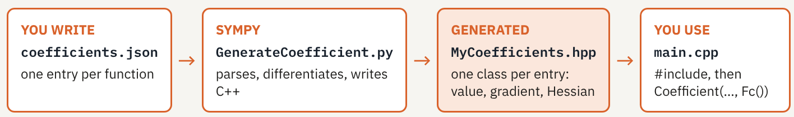

# Tutorial: Coefficients with Sympy

This tutorial explains how the physics of a `SLOTH` problem is described with `Coefficient` objects, and how to write your own coefficients with the `Sympy` interface.

The running example goes from the double-well potential of the Allen-Cahn equation to the free energy of two sintering particles (Cahn-Hilliard + Allen-Cahn), taken from the `tests/Studies/sintering/test1` case of the `SLOTH` repository. The structure of a `main.cpp` is assumed to be known (see the tutorial [SLOTH Input Files in a Nutshell](../InputFile/index.md)).

!!! tip "Slides"
    This tutorial is also available as a slide deck: [download the PDF](SLOTH_coefficients_with_Sympy.pdf).

## 1. Anatomy of a Coefficient

### Step 1 – The physics lives in coefficients

In `SLOTH`, the equation is carried by the integrators: the `AllenCahn` integrator assembles the weak form, the residual and the Jacobian of

```math
\frac{\partial\varphi}{\partial t} = -M\left[\omega\,W'(\varphi) - \lambda\,\Delta\varphi\right]
```

What changes from one material to another is in the **coefficients**: the mobility $`M`$ (`Glossary::Mobility`), the free energy $`\omega W`$ (`Glossary::FreeEnergy`) and the capillarity $`\lambda`$ (`Glossary::Capillary`). For an energy, the integrator also needs the first and second derivatives, used in the residual and the Jacobian of the Newton solver: this is why `SLOTH` generates coefficients with `Sympy`, which differentiates the formula exactly.

### Step 2 – Quantity, scheme and function

```cpp
Coefficient energy(Glossary::FreeEnergy, Scheme::Implicit, W(omega));
```

A `Coefficient` is made of three ingredients:

=== "Quantity"

    A [`Glossary`](../../../../Documentation/User/Glossary/index.md) quantity says **what** the coefficient is: `FreeEnergy`, `Mobility`, `Capillary`, `GradEnergy`, `Temperature`, `Dirichlet`, `Neumann`, …

    Integrators look a coefficient up **by its quantity**: the `AllenCahn` integrator searches the coefficients of the problem for a `FreeEnergy`, a `Mobility` and a `Capillary`.

=== "Scheme"

    The scheme says at which state the function is evaluated:

    | Scheme | Evaluated with | Derivatives in the Jacobian |
    |---|---|---|
    | `Scheme::Implicit` | the current Newton iterate | yes |
    | `Scheme::Explicit` | the fields of the previous time step $`t^n`$ | no |
    | `Scheme::SemiImplicit` | both, see [`explicit_variables`](#step-2-going-further) | for the implicit variables |

    A constant takes no scheme.

=== "Function"

    A constant, a function provided by `SLOTH` such as `W(omega)`, or **your own class** generated by `Sympy` from a JSON file. The latter is the topic of this tutorial.

### Step 3 – Three ways to give the function

=== "A constant"

    ```cpp
    Coefficient capillary(Glossary::Capillary, lambda);
    ```

    No scheme; the derivatives are zero.

=== "A SLOTH built-in"

    `W(omega)`, `Fw(omega)`, `H()`, `Log(a)`, `GradientEnergy(lambda)`: double wells, interpolation function, logarithmic energy and gradient energy, available in any input file (see the [common list of coefficients](../../../../Documentation/User/Coefficients/index.md#common_coefficient)). They are themselves generated by `Sympy` from a JSON file of the `SLOTH` kernel, exactly as your own coefficients will be.

=== "Your own formula"

    ```json
    {
        "expression": "…", 
        "variables": "c", 
        "class_name": "Gc", 
        "outputfile": "MyCoefficients"
    }
    ```

    `Sympy` writes the class `Gc` and its derivatives; it is then used as `Coefficient(…, Gc())`.

## 2. A First Coefficient

### Step 1 – From a formula to a C++ class

{width=900px}

You write the formulas in a JSON file. The script `GenerateCoefficient.py` (in the `scripts` folder of `SLOTH`, or provided by an installed `SLOTH` as `Sloth_COEFFICIENT_SCRIPT`) parses each entry with `Sympy`, computes the first and second derivatives, and writes one C++ class per entry in the header named by `outputfile`. The header is then included in `main.cpp`.

=== "By hand"

    ```shell
    python3 GenerateCoefficient.py -r -f coefficients.json
    ```

    The `-r` option overwrites existing files. Python 3 and `Sympy` are required (see the [ExprTk and Sympy installation](../../../Installation/exprtk_sympy.md) page).

=== "With CMake"

    ```cmake
    add_custom_command(
      OUTPUT ${CMAKE_CURRENT_BINARY_DIR}/MyCoefficients.hpp
      COMMAND ${Python3_EXECUTABLE} ${Sloth_COEFFICIENT_SCRIPT} -r -f ${CMAKE_CURRENT_SOURCE_DIR}/coefficients.json
      WORKING_DIRECTORY ${CMAKE_CURRENT_BINARY_DIR}
      DEPENDS ${CMAKE_CURRENT_SOURCE_DIR}/coefficients.json)
    ```

    The header is regenerated whenever the JSON file changes (see [Using an installed SLOTH](../../../Installation/use_installed.md)).

### Step 2 – The double well, written by you

```json
[
    {
    "expression": "phi*phi*(1-phi)*(1-phi)",
    "variables": "phi",
    "class_name": "DoubleWell",
    "outputfile": "MyCoefficients"
    }
]
```

This entry defines $`W(\varphi)=\varphi^2(1-\varphi)^2`$. The four keys used here are required:

| Key | Meaning |
|---|---|
| `expression` | the formula, in `Sympy` syntax |
| `variables` | the unknowns; derivatives are taken with respect to them (separated by spaces or commas) |
| `class_name` | name of the generated C++ class |
| `outputfile` | basename of the generated `.hpp` file |

The optional keys `constants`, `auxiliary_variables`, `coordinates` and `gradient` are introduced below. In `main.cpp`, the generated class is used like any built-in:

```cpp
#include "MyCoefficients.hpp"

Coefficient energy(Glossary::FreeEnergy, Scheme::Implicit, DoubleWell(omega));
```

!!! note "The prefactor"
    Every generated class accepts one optional argument, the **prefactor** (`omega` above, default `1`). It multiplies the function and all its derivatives. It is convenient for sensitivity studies, or to reuse one formula for several coefficients.

### Step 3 – What Sympy writes

For each entry, the generator writes a class deriving from `FunctionCoefficient` with three functions: the value, the first derivatives (one per variable) and the Hessian. An extract of the class generated for the double well:

```cpp
class DoubleWell : public FunctionCoefficient { … };

// value
double phi = input_vector[0];
double F = std::pow(phi, 2) * std::pow(1 - phi, 2);
return this->prefactor_ * F;

// first derivatives, one per variable
gradient[0] = this->prefactor_ *
  (std::pow(phi, 2) * (2 * phi - 2) + 2 * phi * std::pow(1 - phi, 2));
```

- The derivatives are **exact**, computed symbolically by `Sympy`, not by finite differences.
- The unknowns are read **by position**: the i-th variable of the JSON entry is `input_vector[i]`, the i-th auxiliary variable is `auxiliary_vector[i]`. This is the origin of the [ordering convention](#step-2-one-energy-one-class-per-problem).
- The header is a build product: never edit it by hand, change the JSON file and regenerate.

### Step 4 – Constants, physical constants and time

```json
[
    {
    "expression": "a*x*x + b*x*y + c*z*x*y",
    "variables": "x, y z",
    "constants": "(a:2.0),(b:30.0),(c:0.1)",
    "class_name": "FunctionA",
    "outputfile": "MyCoefficients"
    }
]
```

Constants are written as `(name:value)` pairs separated by commas. They are substituted when the class is generated: changing one means regenerating. A value can also be the name of a `SLOTH` physical constant:

| Value | Meaning |
|---|---|
| `H` | Planck constant (`Physical::H`) |
| `NA` | Avogadro constant (`Physical::NA`) |
| `K` | Boltzmann constant (`Physical::K`) |
| `R` | molar gas constant (`Physical::R`) |
| `T` | current time, updated by `SLOTH` |

The constant `T` makes a coefficient time-dependent, for example `"constants": "(a:2.0),(t:T)"` with `"expression": "a*x*x*t"`.

!!! tip "Constant or prefactor?"
    A constant is frozen when the class is generated; the prefactor is chosen in `main.cpp` for each `Coefficient`. Use the prefactor for a parameter you want to vary between runs or between coefficients.

## 3. Several Fields

### Step 1 – Variables and auxiliary variables

The running example is the sintering of two particles: Cahn-Hilliard solves the density $`c`$, Allen-Cahn solves the grain fields $`\eta_1, \eta_2`$. The same free energy enters both problems:

```math
f(c,\eta_1,\eta_2) = A\,c^2(1-c)^2 + B\Big[c^2 + 6(1-c)\sum_{i}\eta_i^2 - 4(2-c)\sum_{i}\eta_i^3 + 3\Big(\sum_{i}\eta_i^2\Big)^2\Big]
```

A coefficient must therefore say which fields are unknowns and which are only read:

- `variables`: the unknowns of the problem **that uses** the coefficient. `Sympy` differentiates with respect to them; they are read, in order, from the problem's `VARS`.
- `auxiliary_variables`: fields solved by **another** problem. They are only read, with no derivative; they are read, in order, from the auxiliary variables passed as the last argument of the problem.

### Step 2 – One energy, one class per problem

The same formula is therefore generated twice, once per problem, with different roles for the fields:

=== "For Cahn-Hilliard"

    ```json
    {
    "expression": "A*c*c*(1-c)*(1-c) + B*(c*c + 6*(1-c)*Sum(eta[i]*eta[i],(i,1,2)) - 4*(2-c)*Sum(eta[i]*eta[i]*eta[i],(i,1,2)) + 3*(Sum(eta[i]*eta[i],(i,1,2)))^2)",
    "variables": "c",
    "auxiliary_variables": "eta(1..2)",
    "constants": "(A:16.0),(B:1.0)",
    "class_name": "Fc",
    "outputfile": "SinteringCoefficients"
    }
    ```

    ```cpp
    TransientPB ch_pb("CahnHilliard", ch_oper,
                      ch_vars,             // c, mu   → input_vector
                      {ch_coef, ch_coef}, ch_pst,
                      ac_vars);            // η1, η2 → auxiliary_vector
    ```

=== "For Allen-Cahn"

    ```json
    {
    "expression": "A*c*c*(1-c)*(1-c) + B*(c*c + 6*(1-c)*Sum(eta[i]*eta[i],(i,1,2)) - 4*(2-c)*Sum(eta[i]*eta[i]*eta[i],(i,1,2)) + 3*(Sum(eta[i]*eta[i],(i,1,2)))^2)",
    "variables": "eta(1..2)",
    "auxiliary_variables": "c",
    "constants": "(A:16.0),(B:1.0)",
    "class_name": "Feta",
    "outputfile": "SinteringCoefficients"
    }
    ```

    ```cpp
    TransientPB ac_pb("AllenCahn", ac_oper,
                      ac_vars,             // η1, η2 → input_vector
                      {ac_coef, ac_coef}, ac_pst,
                      ch_vars);            // c, mu   → auxiliary_vector
    ```

Cahn-Hilliard solves `c` and `mu`: `c` comes first, so it is `input_vector[0]`, and `mu` is simply not used by `Fc`. Allen-Cahn receives `c` and `mu` as auxiliary fields: `c` is `auxiliary_vector[0]`.

!!! warning "Ordering convention"
    - The variables of the JSON entry follow the order of the problem's `VARS`.
    - The auxiliary variables of the JSON entry follow the order of the problem's auxiliary `VARS`.

    A wrong order is not detected: the wrong field is silently read. See [Use of coefficients in SLOTH problems](../../../../Documentation/User/Coefficients/index.md#pde_coefficient).

### Step 3 – N fields: indexed variables and sums

```json
[
    {
    "expression": "Sum( -(x[i]*x[i])/2.0 + (x[i]*x[i]*x[i]*x[i])/4.0 , (i, 1, 30) )",
    "variables": "x(1..30)",
    "class_name": "Gw",
    "outputfile": "GrainsCoefficients"
    }
]
```

This entry defines

```math
\sum_{i=1}^{30}\Big(\tfrac{1}{4}x_i^4-\tfrac{1}{2}x_i^2\Big)
```

- `x(1..30)` declares the family $`x_1, \dots, x_{30}`$, in `variables` or `auxiliary_variables`.
- `Sum(expression, (i, 1, 30))` sums over it, with `x[i]` inside the expression; several index ranges give double sums.
- The bounds of the sum must be consistent with the declaration.

In the sintering energy, the sums over the grains are written as `Sum(eta[i]*eta[i], (i,1,2))`: the same JSON describes $`N`$ grains by changing the bounds. See [Defining a summation](../../../../Documentation/User/Coefficients/index.md#summation).

### Step 4 – Gradient energies

```json
[
    {
    "expression": "2.5*dot(x,x) + sdot(eta(1..2))",
    "variables": "x",
    "auxiliary_variables": "eta(1..2)",
    "class_name": "GradC",
    "outputfile": "SinteringCoefficients",
    "gradient": true
    }
]
```

With `"gradient": true`, each variable stands for the **gradient** of the field: `dot(x,x)` is $`\nabla x\cdot\nabla x`$ and `sdot(eta(1..2))` is $`\sum_i \nabla\eta_i\cdot\nabla\eta_i`$. This entry defines the gradient energy of the Cahn-Hilliard problem of the sintering test,

```math
\tfrac{5}{2}\,\nabla c\cdot\nabla c + \sum_{i=1}^{2}\nabla\eta_i\cdot\nabla\eta_i
```

used as

```cpp
Coefficient ch_grad(Glossary::GradEnergy, Scheme::Implicit, GradC());
```

A gradient coefficient cannot depend on spatial coordinates. See [Defining a scalar product](../../../../Documentation/User/Coefficients/index.md#scalarproduct).

### Step 5 – A field-dependent mobility

Kinetic coefficients can depend on the fields too. In the sintering test, the Cahn-Hilliard mobility combines volume, vapour, surface and grain-boundary diffusion:

```math
D(c,\eta) = D_{vol}\,\phi(c) + D_{vap}\,\big(1-\phi(c)\big) + D_{surf}\,c(1-c) + D_{gb}\sum_{i\neq j}\eta_i\,\eta_j, \qquad \phi(c)=c^3\,(10-15c+6c^2)
```

```json
[
    {
    "expression": "dvol*c*c*c*(10.0-15.0*c+6.0*c*c) + dvap*(1.0-c*c*c*(10.0-15.0*c+6.0*c*c)) + dsurf*c*(1-c) + dgb*(Sum(eta[i],(i,1,2))*Sum(eta[i],(i,1,2)) - Sum(eta[i]*eta[i],(i,1,2)))",
    "variables": "c",
    "auxiliary_variables": "eta(1..2)",
    "constants": "(dvol:0.04),(dvap:0.002),(dsurf:16.0),(dgb:1.6)",
    "class_name": "D",
    "outputfile": "SinteringCoefficients"
    }
]
```

```cpp
Coefficient ch_mobility(Glossary::Mobility, Scheme::Explicit, D());
```

With `Scheme::Explicit`, the mobility is evaluated with the fields of the previous time step and adds no derivative to the Jacobian. `Sympy` still generates the derivatives, so `Scheme::Implicit` remains possible.

## 4. Coefficients in the Problem

### Step 1 – One collection per variable

```cpp
// Cahn-Hilliard (sintering test)
Coefficient ch_energy(Glossary::FreeEnergy, Scheme::Implicit, Fc());
Coefficient ch_grad(Glossary::GradEnergy, Scheme::Implicit, GradC());
Coefficient ch_capillary(Glossary::Capillary, ch_lambda);
Coefficient ch_mobility(Glossary::Mobility, Scheme::Explicit, D());
Coefficients ch_coef(ch_energy, ch_capillary, ch_mobility, ch_grad);

TransientPB ch_pb("CahnHilliard", ch_oper, ch_vars, {ch_coef, ch_coef}, ch_pst, ac_vars);
```

- **Found by quantity**: the integrator picks the `FreeEnergy`, `Mobility`, `Capillary`… it needs in the `Coefficients` collection; their order inside the collection is free.
- **One collection per variable**: the problem takes a vector of `Coefficients`, as many as variables and in the same order. Cahn-Hilliard has two unknowns, `c` and `mu`, which both receive `ch_coef`.
- **Which quantities?** Each integrator lists the quantities it reads on the [PDEs](../../../../Documentation/User/MultiPhysicsCouplingScheme/Problems/PDEs/index.md) page of the User Manual.

!!! note "Names in the test"
    In `tests/Studies/sintering/test1`, the classes called `Fc` and `Feta` here are named `Gc` and `Geta`.

### Step 2 – Going further

=== "Space-dependent"

    ```json
    "expression": "-pi*t*cos(pi*x)",
    "coordinates": "x,y",
    ```

    The `coordinates` key makes a coefficient depend on the position, typically for non-uniform boundary conditions attached to edges with `set_bdr_index_coef` (see `tests/HeatTransfer/2D/test5`). Coordinates are not unknowns. See [coefficients depending on spatial coordinates](../../../../Documentation/User/Coefficients/index.md#coordcoef).

=== "Conditional"

    ```json
    "expressions": [
        {"expression": "…", "lower": 0.0, "upper": 0.75},
        {"expression": "…", "default": true}],
    "range_variable": "x1",
    ```

    Piecewise formulas on one range variable, with a default expression outside the ranges. See [Defining a conditional coefficient](../../../../Documentation/User/Coefficients/index.md#condcoef).

=== "Semi-implicit"

    ```json
    "variables": "x(1..30)",
    "explicit_variables": "xn(1..30)",
    ```

    The `xn` variables are taken at the previous time step; the coefficient is used with `Scheme::SemiImplicit`. See [Defining a semi-implicit coefficient](../../../../Documentation/User/Coefficients/index.md#semiimplicit).

=== "Combined"

    ```cpp
    auto P = ProductCoefficient({&A, &B});
    auto S = SumCoefficient({&P, &P});
    ```

    Products and sums of generated classes, built in `main.cpp`. See [Defining a product or a sum](../../../../Documentation/User/Coefficients/index.md#productfonctioncoefficient).

### Step 3 – Six checks before running

!!! warning "Checklist"
    1. **Variable order**: the JSON `variables` follow the order of the problem's `VARS`.
    2. **Auxiliary order**: the JSON `auxiliary_variables` follow the order of the problem's auxiliary `VARS`.
    3. **Every symbol declared**: once, as a variable, an auxiliary variable, a constant or a coordinate.
    4. **Regenerate**: after any change to the JSON file (CMake does it with a custom command).
    5. **The right scheme**: `Implicit` for energies, `Explicit` to freeze a coefficient at $`t^n`$, `SemiImplicit` with `explicit_variables`.
    6. **The right quantity**: the `Glossary` type the integrator expects.

## 5. Where to Find Information

| Where | What |
|---|---|
| [Coefficients](../../../../Documentation/User/Coefficients/index.md) page of the User Manual | every key of the JSON file |
| [PDEs](../../../../Documentation/User/MultiPhysicsCouplingScheme/Problems/PDEs/index.md) page of the User Manual | the quantities read by each integrator |
| [ExprTk and Sympy](../../../Installation/exprtk_sympy.md), [Using an installed SLOTH](../../../Installation/use_installed.md) | installing `Sympy`; generating coefficients with CMake |
| `tests/Studies/sintering/test1` | multiphase energy, gradient energy, mobility |
| `tests/HeatTransfer/2D/test5` | coefficients depending on spatial coordinates |
| `tests/Coefficients/test2` | constants |
| [SLOTH Input Files in a Nutshell](../InputFile/index.md) | the rest of the `main.cpp` |
