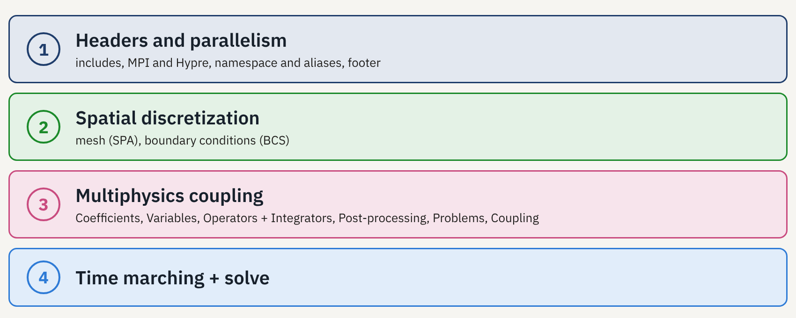
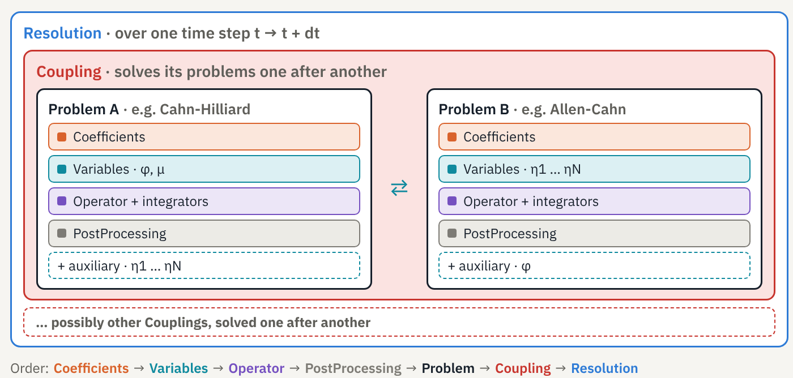
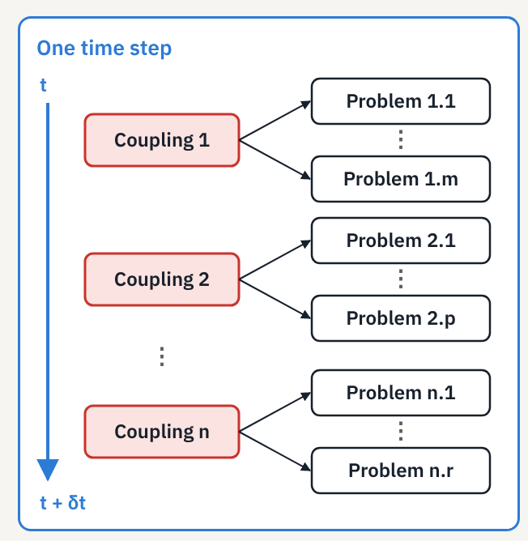

# Tutorial: SLOTH Input Files in a Nutshell

This tutorial explains how a `SLOTH` simulation is built, independently of any application: the philosophy of the code, the structure of an input file in four parts, then each part in detail.

It is the natural companion of the [Basic features](../../Simple/index.md) page: Basic features walks through one complete example (Allen-Cahn in 1D), while this tutorial gives the general pattern behind every `SLOTH` input file, including multiphase and multiphysics cases.

!!! tip "Slides"
    This tutorial is also available as a slide deck: [download the PDF](SLOTH_input_files_in_a_nutshell.pdf).

## 1. The SLOTH Philosophy

Four ideas are enough to understand a `SLOTH` input file.

=== "The input file is a program"

    There is no text input file: a `SLOTH` input file is a compiled `main.cpp` that assembles `SLOTH` objects. C++ typing catches many inconsistencies at compile time, and any function can be written. The same file runs on a workstation or on a cluster.

=== "One equation = one operator + integrators"

    Neither the weak form, nor the assembly, nor the nonlinear solver are written by the user. One chooses an operator, `TransientOPE` for a transient simulation or `SteadyOPE` for a steady one, and names its integrators, which carry the variational formulation of the problem.

=== "Physics is specified analytically"

    The energy functional and the kinetic parameters (mobilities) are `SLOTH` `Coefficient` objects, written as formulas in a JSON file and differentiated by Sympy. This is what makes multiphase simulations simple.

=== "A multiphysics scheme built by nesting"

    `TimeDiscretization` ⊃ { `Coupling` ⊃ { `Problem` } }: a time step solves couplings, each coupling solves problems. Adding a physics means adding a `Problem`.

## 2. An Input File in Four Parts

Every `SLOTH` `main.cpp` follows the same skeleton, whatever the problem:

{width=800px}

1. **Headers and parallelism**: includes, MPI and Hypre, namespace and aliases, footer.
2. **Spatial discretization**: mesh (`SPA`) and boundary conditions (`BCS`).
3. **Multiphysics coupling**: coefficients, variables, operators and integrators, post-processing, problems, coupling. This is where the physics comes in.
4. **Time marching and resolution**: `TimeDiscretization`, then `time.solve()`.

!!! note "Parameters"
    Options are almost always passed through `Parameters(Parameter(name, value), ...)`.

## 3. Part 1 – Headers and Parallelism

Part 1 is identical from one simulation to the next: it opens and closes the simulation.

```cpp
// ── header ──
#include "Sloth/sloth.hpp"      // all of SLOTH
#include "Sloth/tests.hpp"      // test utilities
#include "MyCoefficients.hpp"   // your Sympy-generated .hpp
int main(int argc, char* argv[]) {
  setVerbosity(Verbosity::Normal);   // output level
  mfem::Mpi::Init(argc, argv);       // MPI
  mfem::Hypre::Init();               // Hypre solvers
  Profiling::getInstance().enable();
  using namespace Sloth2D;           // dimension, aliases

  // … parts 2, 3 and 4 …

// ── footer ──
  Profiling::getInstance().print();  // timings
  MPI_Finalize();
  return 0;
}
```

`using namespace Sloth2D;` (or `Sloth1D`, `Sloth3D`) sets the dimension and gives access to the main aliases:

| Alias | Meaning |
|---|---|
| `SPA` | spatial discretization |
| `SPAS` | vector of `SPA` |
| `BCS` | boundary conditions |
| `VAR` / `VARS` | one variable / a set of `VAR` |
| `PST` | post-processing |
| `TransientOPE` / `SteadyOPE` | an operator type |
| `TransientPB` / `SteadyPB` | a problem type |

See the [Aliases](../../../../Documentation/User/Aliases/index.md) page of the User Manual for the full list. When the factories of Part 2 are used, `deleteSpatialDiscretization` is added to the footer.

## 4. Part 2 – Spatial Discretization

### Step 1 – The mesh: a `SPA` object

A mesh is built with one call and (at least) four arguments:

```cpp
SPA spatial("InlineSquareWithQuadrangles", 1, 0, std::make_tuple(200, 200, 50., 50.));
```

1. **mesh type**: `"GMSH"` to read a `.msh` file (ASCII v2), or an MFEM "inline" mesh: `InlineLineWithSegments` (1D), `InlineSquareWithQuadrangles` / `InlineSquareWithTriangles` (2D), `InlineSquareWithTetraedres` / `InlineSquareWithHexaedres` (3D);
2. **element order**: `1` = linear;
3. **uniform refinements**: `0` = none;
4. **dimensions**: number of cells then lengths in each direction (or the file name for GMSH).

Optional arguments:

- **periodic mesh**: a vector of translations;
- **AMR**: `enable_nc_mesh = true` for a non-conforming mesh, which cannot be switched on afterwards (see the [AMR tutorial](../AMR/index.md));
- **GMSH file**: `SPA("GMSH", 1, 0, "mesh.msh")`.

See the [Meshing](../../../../Documentation/User/SpatialDiscretization/Meshing/index.md) page of the User Manual for all the meshing options.

### Step 2 – Boundary conditions: a `BCS` object

Boundary conditions are a `BCS` object built on a `SPA`, with exactly **one `Boundary` per edge**:

```cpp
BCS bcs(&spatial, {
  Boundary("lower", 0, "Neumann"),
  Boundary("right", 1, "Dirichlet", 1.),
  Boundary("upper", 2, "Neumann"),
  Boundary("left",  3, "Dirichlet", 0.)});
```

A `Boundary` is made of a free name, an index, a type (`Dirichlet`, `Neumann`, `Robin`, `Periodic`) and, for a uniform Dirichlet condition, its value.

!!! warning "The right index"
    The name is free, but the index must match the edge attribute in the mesh. For the MFEM square: `0` bottom, `1` right, `2` top, `3` left. For a GMSH mesh, use the attributes defined in the file.

Each variable receives its `BCS` when it is created (see [Part 3](#5-part-3-multiphysics-coupling)). See the [Boundary Conditions](../../../../Documentation/User/SpatialDiscretization/BoundaryConditions/index.md) page of the User Manual for all condition types.

### Step 3 – Going further: several fields on one mesh

In multiphase simulations, or with AMR, several fields often share one mesh. The same result can be obtained by hand or with factories:

=== "Two fields, by hand"

    ```cpp
    // shared, non-conforming mesh
    SPA spatial_phi("InlineSquareWithQuadrangles",
                    1, 0, std::make_tuple(200, 200, 50., 50.),
                    true);
    SPA spatial_mu(spatial_phi.get_mesh(), 1);
    // one common list of edges
    auto boundaries = {
      Boundary("lower", 0, "Neumann"),
      Boundary("right", 1, "Neumann"),
      Boundary("upper", 2, "Neumann"),
      Boundary("left",  3, "Neumann")};
    // one BCS per variable
    BCS bcs_phi(&spatial_phi, boundaries);
    BCS bcs_mu(&spatial_mu, boundaries);
    ```

    Each variable gets its own `SPA`, built on the mesh of the first one with `get_mesh()`. Orders may differ. This is required for AMR, since all variables must follow the same refinements.

=== "N fields, factory"

    ```cpp
    const int N = 5;  // 5 grains
    // N spaces, one mesh
    SPAS spatials = setSpatialDiscretization(
        N, "InlineSquareWithQuadrangles",
        1, 0, std::make_tuple(200, 200, 50., 50.),
        true);
    // same list of edges
    auto bcs = setBoundaryConditions(N, spatials, boundaries);

    // … variables, problems, time …

    // in the footer
    deleteSpatialDiscretization(spatials);
    ```

    `setSpatialDiscretization(N, ...)` takes, after `N`, the arguments of the `SPA` constructor (`setPeriodicSpatialDiscretization` for a periodic mesh). `setBoundaryConditions` builds the `N` `BCS` from a single list of `Boundary`: `bcs[i]` goes with `spatials[i]`. Objects created by the factory are freed in the footer.

!!! note "Non-uniform boundary values"
    A non-uniform boundary value is a `Coefficient` of type `Glossary::Dirichlet`, `Neumann` or `Robin`, attached to the edges with `set_bdr_index_coef`, and written in a JSON file like the energies (`x`, `y` as auxiliary, `t` for time):

    ```cpp
    Coefficient bc(Glossary::Dirichlet, …);
    bc.set_bdr_index_coef({1});
    ```

See the factory sections of the [Meshing](../../../../Documentation/User/SpatialDiscretization/Meshing/index.md#factory) and [Boundary Conditions](../../../../Documentation/User/SpatialDiscretization/BoundaryConditions/index.md#factory) pages.

## 5. Part 3 – Multiphysics Coupling

### Overview – One time step: nested boxes

At each time step, `TimeDiscretization` solves one or more `Coupling`, one after another. Each `Coupling` solves its `Problem` one after another (partitioned scheme). Each `Problem` gathers its coefficients, its primary variables, its operator with its integrators and its post-processing; it reads the fields of the other problems through its auxiliary variables, without solving them.

{width=800px}

In the file, objects are written from the inside out, always in the same order:

**Coefficients → Variables → Operator → PostProcessing → Problem → Coupling → Resolution (Part 4)**

### Step 1 – Physics: `Coefficient` objects

Coefficients carry the physics, kept separate from the numerics:

```cpp
// a constant
Coefficient capillary(Glossary::Capillary, lambda);
// a function provided by SLOTH
Coefficient w(Glossary::FreeEnergy, Scheme::Implicit, W(omega));
// a function written in coefficients.json, generated by Sympy
Coefficient f(Glossary::FreeEnergy, Scheme::Implicit, Gc());
// the collection given to the problem
Coefficients ch_coef(f, capillary, mobility, grad_energy);
```

A `Coefficient` combines:

- a **type**: a quantity of the [Glossary](../../../../Documentation/User/Glossary/index.md) (`FreeEnergy`, `Mobility`, `Capillary`, `GradEnergy`, …);
- a **scheme**: `Implicit`, `Explicit` or `SemiImplicit` (not needed for constants);
- a **function**: a constant, a function provided by `SLOTH` such as the double well `W(omega)` or a class generated by Sympy from `coefficients.json` with its first and second derivatives (`FunctionCoefficient` from JSON), or an ExprTk expression written directly as a string.

The coefficients given to a problem are gathered in a `Coefficients` object.

!!! warning "Convention"
    In a function, the unknowns follow the order of the problem's `Variables`, then that of the auxiliary variables.

See the [Coefficients](../../../../Documentation/User/Coefficients/index.md) page of the User Manual and the [ExprTk and Sympy installation](../../../Installation/exprtk_sympy.md) page.

### Step 2 – The unknowns: `VAR` and `VARS`

```cpp
auto phi = VAR(&spatial, bcs, "phi", Glossary::PhaseField, 2, phi_ic);
auto mu  = VAR(&spatial, bcs, "mu", Glossary::ChemicalPotential, 2, mu_ic);
auto ch_vars = VARS(phi, mu);    // the Cahn-Hilliard unknowns
```

A `VAR` is built on:

- a `SPA` and its `BCS`: the space and its boundary conditions (Part 2);
- a **name**: the one used in the ParaView outputs;
- a **type**: a Glossary quantity;
- a **storage depth** (2 in the example);
- an **initial condition**: a constant, a predefined `AnalyticalFunctions`, a user-written `std::function`, or an MFEM file for a restart.

The variables of a problem are gathered in a `VARS`. `SLOTH` distinguishes two kinds of variables, defined the same way:

- **primary** variables, solved by the problem: `φ` and `μ` for Cahn-Hilliard;
- **auxiliary** variables, solved by another problem and only read; they are passed as the problem's last argument. This is the coupling mechanism.

See the [Variables](../../../../Documentation/User/Variables/index.md) page of the User Manual.

### Step 3 – One physics = one operator + integrators

Every PDE is written

```math
F(U) = G(U)
```

where $`F`$ is the form associated with the time derivative and $`G`$ with the spatial operators ($`F=0`$ for a steady problem). The operator solves this system with a unified Newton-Raphson, even for linear equations; an LBFGS solver is also available. Each term is an integrator providing its contribution to the residual and the Jacobian.

=== "TransientOPE · transient"

    ```cpp
    TransientOPE(spatials, {"CahnHilliard"}, scheme, "SplitTimeDerivative")
    ```

    The spaces, the list of $`G`$ integrators, the time scheme and the $`F`$ integrator.

=== "SteadyOPE · steady, F = 0"

    ```cpp
    SteadyOPE(spatials, {"AllenCahn"})
    ```

    The spaces and the list of $`G`$ integrators only.

| Family | Term | Integrators |
|---|---|---|
| Time | $`F`$ | `TimeDerivative`, `SplitTimeDerivative`, `HeatTimeDerivative`,... |
| Phase field | $`G`$ | `AllenCahn`, `SplitAllenCahn`, `CahnHilliard`,... |
| Diffusion, heat | $`G`$ | `Fick`, `MassFlux`, `Fourier`,...|
| Sources | $`G`$ | `MeltingConstant`, `MeltingCalphad`, `LatentHeat`,... |

Several integrators can be combined in $`G`$, for example `AllenCahn` + `MeltingConstant`.

!!! warning "Required pairings"
    - `CahnHilliard` and `SplitAllenCahn` go with `SplitTimeDerivative`;
    - melting terms go with `AllenCahn`;
    - `LatentHeat` goes with `Fourier`.

    Coefficients (mobility, energy) are given to the problem, not to the operator.

See the [PDEs](../../../../Documentation/User/MultiPhysicsCouplingScheme/Problems/PDEs/index.md) page of the User Manual for all integrators and their equations.

### Step 4 – Post-processing: a `PST` object

```cpp
auto pst_params = Parameters(
  Parameter("main_folder_path", "Saves"),
  Parameter("calculation_path", "CahnHilliard"),
  Parameter("frequency", 100));
auto ch_pst = PST(&spatial, pst_params);
```

A `PST` is built on a space and a list of parameters: the root folder, the problem's sub-folder and the output frequency (`iterations_list` or `times_list` can be used instead of `frequency`). The variables of the associated problem(s) are written in ParaView format (VTK).

- **Optional**: with no `PST`, there is no ParaView output for the problem.
- **Shareable**: one `PST` for several problems gives a single ParaView file.
- **Specialized**: integrals over the domain can be computed, and coefficients can be exported to the VTK.

See the [Post-Processing](../../../../Documentation/User/PostProcessing/index.md) page of the User Manual for all output parameters.

### Step 5 – Putting it together: a `Problem`

```cpp
TransientPB ch_pb("CahnHilliard",   // name
    ch_oper,                        // operator + integrators
    ch_vars,                        // primary variables φ, μ
    {ch_coef, ch_coef},             // one Coefficients per variable
    ch_pst,                         // post-processing (optional)
    ac_vars);                       // auxiliary η1 … ηN (optional)
```

`TransientPB` (or `SteadyPB` with a `SteadyOPE`) takes a name, the operator, the primary variables, a vector of `Coefficients`, then optionally the post-processing and the auxiliary variables as last argument.

!!! warning "The vector of Coefficients"
    - **As many `Coefficients` as variables**: the vector has the size of `VARS`.
    - **In the same order**: the i-th `Coefficients` goes with the i-th variable.

Optionally, a `Convergence` object (one `PhysicalConvergence` criterion per variable) stops the simulation when the steady state is reached (see the [Convergence](../../../../Documentation/User/MultiPhysicsCouplingScheme/Convergence/index.md) page).

See the [Problems](../../../../Documentation/User/MultiPhysicsCouplingScheme/Problems/index.md) page of the User Manual.

### Step 6 – Chaining problems: a `Coupling`

=== "Two different problems"

    ```cpp
    auto cc = Coupling("CH/AC", ac_pb, ch_pb);
    ```

=== "N identical problems"

    ```cpp
    std::vector<TransientPB> ac_pbs;
    // … fill the N problems …
    auto cc = setCoupling<N>("Multigrains", ac_pbs);
    ```

    `N` must equal the size of the vector.

A `Coupling` has a name and a list of problems, solved one after another at each time step, in the order they are written: this is a **partitioned scheme**. Each problem reads the fields of the others through its auxiliary variables. Inside a problem, on the other hand, the unknowns are solved together: `φ` and `μ` of Cahn-Hilliard form a **monolithic** system.

See the [Couplings](../../../../Documentation/User/MultiPhysicsCouplingScheme/Couplings/index.md) page of the User Manual.

## 6. Part 4 – Time Marching and Resolution

```cpp
auto params = Parameters(
  Parameter("initial_time", 0.),
  Parameter("final_time", t_final),
  Parameter("time_step", dt));
auto time = TimeDiscretization(params, cc);
time.solve();    // runs the simulation
```

`TimeDiscretization` takes a list of parameters (initial time, final time, time step) and one or more `Coupling`, solved one after another at each step: `TimeDiscretization(params, cc1, cc2, …)`. `time.solve()` starts the loop. Then comes the footer of Part 1.

{width=400px}

Two useful options:

- **Variable time step** (but not adaptive): a `std::function<double(double)>` replaces `time_step`;
- **Restart**: `initial_iteration` restarts from a saved state (see the [Save/Restart tutorial](../SaveRestart/index.md)).

See the [Time](../../../../Documentation/User/MultiPhysicsCouplingScheme/Time/index.md) page of the User Manual for all the time-loop options.

## 7. From the Simple Case to the Multiphase Case

A multiphase Cahn-Hilliard + Allen-Cahn simulation keeps exactly the same skeleton as the simple case of [Basic features](../../Simple/index.md). Parts 1, 2 and 4 only change with the dimension (`Sloth2D` or `Sloth3D`, square, cube or GMSH mesh); only Part 3 changes:

| | Simple case | Multiphase case |
|---|---|---|
| One problem per equation | One `Problem`: Allen-Cahn | Cahn-Hilliard ($`\phi`$, $`\mu`$) + Allen-Cahn ($`\eta_1 \dots \eta_N`$), in one `Coupling` |
| Auxiliary variables | None | Each problem reads the other's fields without solving them |
| Energy | `W(omega)`, `H()`: provided by `SLOTH` | $`f(\phi, \eta_1 \dots \eta_N)`$ in the JSON file, differentiated by Sympy |

## 8. Where to Find Information

| Step | Where | What |
|---|---|---|
| Get started | [Getting started](../../../index.md), [Basic features](../../Simple/index.md) | install and build; the structure of an input file |
| Get inspired | [Examples](../../../Examples/index.md), `tests/` in the [SLOTH repository](https://github.com/Collab4Sloth/SLOTH) | commented cases; complete `main.cpp` files |
| Go deeper | [User Manual](../../../../Documentation/User/index.md), [PDEs](../../../../Documentation/User/MultiPhysicsCouplingScheme/Problems/PDEs/index.md), [Tutorials](../index.md) | all the options; operators and integrators; AMR, save/restart |
| Get help | [mfem.org](https://mfem.org), [GitHub issues](https://github.com/Collab4Sloth/SLOTH/issues) | numerics and MPI; bugs and questions |
